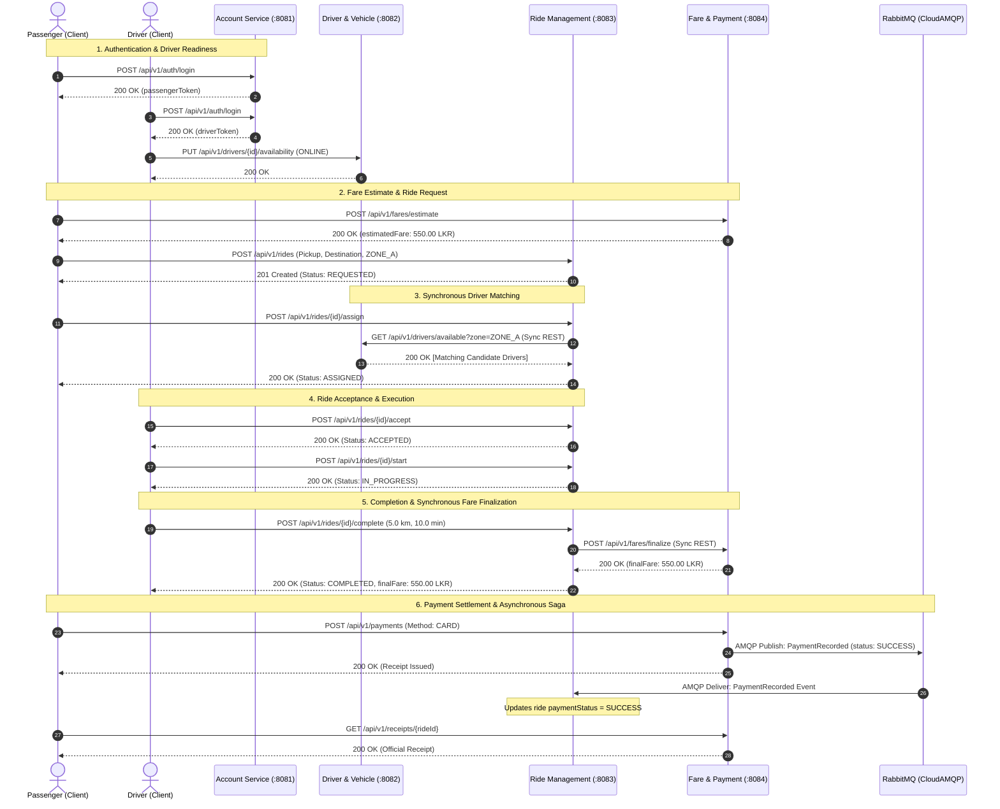

# IT3130 — Application Development | Technical Report

---

# 1. Title Page

**RideLink: A Distributed Backend Microservices Architecture for a Ride-Sharing Platform**

**Institution:** Sri Lanka Institute of Information Technology (SLIIT)  
**Faculty:** Faculty of Computing — Department of Information Technology  
**Module:** IT3130 — Application Development (Year 3, Semester 1)  
**Assessment:** Group Assignment (Weight: 30% of Module Total)  
**Academic Year / Semester:** 2026 / Y3S1  
**Group Identification:** Group XX *(Replace with assigned Group ID)*  
**Repository Release Tag:** `v1.0.0-final-submission`  
**Date of Submission:** October 2026  

### Service Ownership & Group Identification Table

| Member No. | Student Full Name | Student Registration No. (IT No.) | Assigned Microservice Ownership | Port & Assigned Database |
| :---: | :--- | :---: | :--- | :--- |
| **Member 1** | *[Student 1 Full Name]* | *[IT Number 1]* | **Account & Identity Service** | Port `8081` \| `account_db` |
| **Member 2** | *[Student 2 Full Name]* | *[IT Number 2]* | **Driver & Vehicle Service** | Port `8082` \| `driver_vehicle_db` |
| **Member 3** | *[Student 3 Full Name]* | *[IT Number 3]* | **Ride Management Service** | Port `8083` \| `ride_mgmt_db` |
| **Member 4** | *[Student 4 Full Name]* | *[IT Number 4]* | **Fare & Payment Service** | Port `8084` \| `fare_payment_db` |

---

# 2. Introduction

RideLink is a fictional, enterprise-grade backend ride-sharing platform inspired by modern on-demand mobility systems such as Uber and PickMe. Designed to support high operational velocity, clear business encapsulation, and horizontal scalability, the system decomposes core ride-booking capabilities into four independently executable Spring Boot microservices: Account Service, Driver & Vehicle Service, Ride Management Service, and Fare & Payment Service. In strict accordance with the assignment brief (§6.5), the platform is developed under a **backend-only scope**; no web or mobile frontend was built or required. Instead, each microservice exposes interactive OpenAPI 3.0 (Swagger UI) interfaces, and end-to-end integration workflows are verified, automated, and demonstrated using a shared, environment-driven Postman test collection.

---

# 3. Architecture & Service Decomposition (G1)

### 3.1 Architecture & Service Decomposition

The RideLink platform applies Domain-Driven Design (DDD) principles to decompose the ride-sharing problem space into four cohesive, loosely coupled bounded contexts:

1. **Account & Identity Service (`:8081`):** Governs user identity, credential security, role-based access control (RBAC), and authentication token lifecycles.
2. **Driver & Vehicle Service (`:8082`):** Manages driver operational readiness, vehicle technical specifications, real-time simulated location telemetry, and candidate driver availability.
3. **Ride Management Service (`:8083`):** Functions as the central workflow orchestrator, managing ride bookings, automated candidate discovery, state machine transitions, and trip history.
4. **Fare & Payment Service (`:8084`):** Governs financial computations, upfront trip estimates, final fare calculations, simulated payment settlements, immutable receipts, and event publishing.

```mermaid
flowchart TB
    subgraph Clients["Supported Demonstration Clients (§6.5)"]
        Swagger["Swagger UI Documentation\n(:8081, :8082, :8083, :8084)"]
        Postman["Automated Postman Collection\n(RideLink Local Environment)"]
    end

    subgraph Service1["Member 1: Account Service (:8081)"]
        AccCtrl["AccountController"]
        AccSvc["AccountService"]
        AccDB[(MongoDB: account_db)]
        AccCtrl --> AccSvc --> AccDB
    end

    subgraph Service2["Member 2: Driver & Vehicle Service (:8082)"]
        DrvCtrl["DriverController"]
        DrvSvc["DriverService"]
        DrvDB[(MongoDB: driver_vehicle_db)]
        DrvCtrl --> DrvSvc --> DrvDB
    end

    subgraph Service3["Member 3: Ride Management Service (:8083)"]
        RideCtrl["RideController"]
        RideSvc["RideService (Orchestrator)"]
        RideListener["PaymentRecordedListener"]
        RideDB[(MongoDB: ride_mgmt_db)]
        RideCtrl --> RideSvc --> RideDB
        RideListener --> RideSvc
    end

    subgraph Service4["Member 4: Fare & Payment Service (:8084)"]
        FareCtrl["FareController"]
        FareSvc["FareService"]
        FarePublisher["RabbitTemplate"]
        FareDB[(MongoDB: fare_payment_db)]
        FareCtrl --> FareSvc --> FareDB
        FareSvc --> FarePublisher
    end

    subgraph Broker["CloudAMQP Message Broker"]
        Exchange["Exchange: ridelink.payment\n(topic)"]
        Queue["Queue: ride.payment.recorded\n(durable)"]
        Exchange -->|routingKey: payment.recorded| Queue
    end

    Clients -->|HTTP REST + Bearer JWT| AccCtrl
    Clients -->|HTTP REST + Bearer JWT| DrvCtrl
    Clients -->|HTTP REST + Bearer JWT| RideCtrl
    Clients -->|HTTP REST + Bearer JWT| FareCtrl

    RideSvc -.->|Sync REST: GET /drivers/available?zone=X\n(Bearer Token Forwarded)| DrvCtrl
    RideSvc -.->|Sync REST: POST /fares/finalize\n(Bearer Token Forwarded)| FareCtrl

    FarePublisher ==>|AMQP Publish: PaymentRecorded| Exchange
    Queue ==>|AMQP Consume: PaymentRecorded| RideListener
```

#### Explicit Data-Ownership & Boundary Statement
In strict compliance with §6.1, **every microservice maintains exclusive ownership over its own persistence boundary**. The team configured a single MongoDB Atlas cluster partitioned into four completely separate logical databases: `account_db`, `driver_vehicle_db`, `ride_mgmt_db`, and `fare_payment_db`. Each database is accessed exclusively through a dedicated, role-scoped Atlas user credential (`account_user`, `driver_vehicle_user`, `ride_mgmt_user`, `fare_payment_user`). **No service is permitted to read, write, or join tables/collections belonging to another service.** Entities across boundaries are linked exclusively through immutable, globally unique string UUIDs (e.g., `userId`, `driverId`, `rideId`).

Furthermore, the team established two definitive architectural contracts to prevent overlap:
- **Operational vs. Allocative Boundary:** *Driver & Vehicle Service answers "who is available"; Ride Management Service decides "who is assigned."* Member 2 maintains driver readiness; Member 3 runs allocation algorithms.
- **Monetary vs. State Boundary:** *Fare & Payment Service owns monetary calculation and settlement; Ride Management Service owns ride lifecycle state.* Member 4 never mutates ride state directly; Member 3 updates payment state upon receiving verified event messages.

#### Monolith vs. Microservices Comparison
To justify the architectural decomposition, the team evaluated the selected microservices architecture against a traditional monolithic Spring Boot application:

| Evaluation Dimension | Monolithic Architecture | RideLink Microservices Architecture | Architectural Rationale for RideLink |
| :--- | :--- | :--- | :--- |
| **Deployment Independence** | All domains packaged into a single executable JAR; any change requires redeploying the entire platform. | Each of the 4 microservices is built, tested, and deployed as an independent container/process. | Driver location updates and ride orchestration experience high feature churn without risking account authentication. |
| **Fault Isolation** | Memory leaks or crashes in fare calculations bring down identity, booking, and driver tracking. | Failures are confined within process boundaries. | A transient crash in payment settlement does not prevent active drivers from accepting or starting rides. |
| **Scalability & Resource Profiles** | Uniform scaling of the entire monolith, wasting compute resources. | Independent horizontal scaling based on domain traffic. | Driver location ingestion requires high I/O throughput; account registration has low, steady throughput. |
| **Data Decoupling** | Temptation to execute cross-table relational joins, creating tight data schema coupling. | Bounded contexts with private databases per service (`account_db`, `ride_mgmt_db`, etc.). | Guarantees compliance with Domain-Driven Design (DDD) and allows independent schema evolution. |
| **Operational Complexity** | Simple local development; zero interprocess network latency. | Distributed network latency, partial failures, and event choreography complexity. | Microservices trade localized operational simplicity for long-term scalability, modularity, and team autonomy. |

---

### 3.2 Technology Stack & Justification (G1, §8)

The table below documents every core architectural component, the alternative considered, and the technical justification — including practical trade-offs regarding team familiarity under compressed academic timelines:

| Layer / Component | Selected Technology | Alternative Considered | Technical Justification & Trade-off Analysis |
| :--- | :--- | :--- | :--- |
| **Core Framework** | **Java 21 LTS & Spring Boot 4.1.1** | Node.js / Express (MERN Stack) | Express was strictly prohibited by assignment brief §6 and rules #1. Java 21 LTS with Spring Boot provides enterprise-grade type safety, dependency injection, and native support for record types. |
| **Repository Layout** | **Maven Multi-Module Monorepo** | Multi-Repo (4 isolated Git repositories) | §6.4 explicitly mandated "one shared Git repository accessible to the teaching team." A multi-module monorepo maintains single-command verification (`./mvnw verify`) while enforcing modularity via independent POM files. |
| **Database Engine** | **MongoDB Atlas (Document NoSQL)** | Relational DB (PostgreSQL / MySQL) | MongoDB provides flexible JSON schema modeling for polymorphic objects (such as vehicle specifications embedded within driver documents) and simplifies rapid prototyping without relational migration scripts. |
| **Database Deployment** | **Hosted Atlas M0 Free Tier** | Local Dockerized MongoDB Daemon | Hosted Atlas provided consistent, zero-setup cloud databases accessible by all group members without running local background daemons or encountering cross-platform Docker port conflicts. |
| **Asynchronous Messaging** | **RabbitMQ via CloudAMQP** | Apache Kafka / AWS SQS | Kafka introduces significant cluster management complexity and Zookeeper/KRaft overhead. RabbitMQ offers lightweight AMQP routing, durable topic exchanges, and immediate message settlement suited for transaction saga choreographies. CloudAMQP eliminated local server maintenance. |
| **Synchronous Interservice Communication** | **Spring 6 `RestClient`** | Spring Cloud OpenFeign / gRPC | OpenFeign requires heavy Spring Cloud dependencies and complex interface abstractions. Spring 6 `RestClient` provides a modern, fluent, synchronous HTTP client with built-in header propagation and low overhead. |
| **Security Architecture** | **Stateless JWT (HMAC-SHA256)** | Statefull Session Cookies / OAuth2 (Keycloak) | Stateful cookies violate microservice decoupling and require shared session stores (Redis). Dedicated OAuth2 servers (Keycloak) were too heavy for the assignment scope. Shared HMAC secrets allow decentralized, instantaneous token validation across all services. |
| **API Documentation** | **SpringDoc OpenAPI 3.0 / Swagger UI** | Manual Postman Documentation / Raw YAML | SpringDoc automatically inspects controller annotations (`@Valid`, `@RequestBody`) and generates live Swagger UI endpoints per service with built-in JWT Bearer authentication, eliminating manual drift. |
| **Continuous Integration** | **GitHub Actions** | Jenkins / GitLab CI | Native GitHub integration directly satisfied §6.4 requirements, automatically compiling, testing, and verifying all four modules on pull requests targeting `main` and `develop`. |

---

# 4. API Design (G2, G5)

### 4.1 Per-Service Endpoint Summary Catalog

The RideLink platform exposes 22 primary REST endpoints conforming to RESTful architectural guidelines:

| Service | Method | Route Path | Access / Role | Functional Description | Expected Status Codes |
| :--- | :---: | :--- | :---: | :--- | :---: |
| **Account** | `POST` | `/api/v1/accounts/register` | Public | Onboards passenger or driver | `201 Created`, `400`, `403`, `409` |
| **Account** | `POST` | `/api/v1/auth/login` | Public | Authenticates credentials; returns JWT | `200 OK`, `400`, `401` |
| **Account** | `GET` | `/api/v1/accounts/me` | Authenticated | Fetches profile of caller | `200 OK`, `401`, `404` |
| **Account** | `PUT` | `/api/v1/accounts/me` | Authenticated | Updates contact/name details | `200 OK`, `400`, `401` |
| **Account** | `PATCH` | `/api/v1/accounts/{id}/status` | `ROLE_ADMIN` | Modifies account active status | `200 OK`, `400`, `401`, `403` |
| **Driver & Vehicle** | `POST` | `/api/v1/drivers/profile` | `ROLE_DRIVER` | Registers driver vehicle & license | `201 Created`, `400`, `403`, `409` |
| **Driver & Vehicle** | `PUT` | `/api/v1/drivers/{id}/availability` | `ROLE_DRIVER` | Toggles ONLINE/OFFLINE status | `200 OK`, `400`, `403`, `404` |
| **Driver & Vehicle** | `PUT` | `/api/v1/drivers/{id}/location` | `ROLE_DRIVER` | Updates simulated GPS coordinates | `200 OK`, `400`, `403`, `404` |
| **Driver & Vehicle** | `GET` | `/api/v1/drivers/available` | Authenticated | Queries online drivers by zone | `200 OK`, `400` |
| **Driver & Vehicle** | `GET` | `/api/v1/drivers/{id}` | Authenticated | Retrieves driver operational profile | `200 OK`, `404` |
| **Ride Management** | `POST` | `/api/v1/rides` | `ROLE_PASSENGER` | Creates booking in REQUESTED state | `201 Created`, `400`, `403` |
| **Ride Management** | `POST` | `/api/v1/rides/{id}/assign` | `ROLE_PASSENGER` | Queries Member 2 & assigns driver | `200 OK`, `403`, `404`, `409` |
| **Ride Management** | `POST` | `/api/v1/rides/{id}/accept` | `ROLE_DRIVER` | Driver accepts ride (ACCEPTED) | `200 OK`, `403`, `404`, `409` |
| **Ride Management** | `POST` | `/api/v1/rides/{id}/start` | `ROLE_DRIVER` | Begins trip (IN_PROGRESS) | `200 OK`, `403`, `404`, `409` |
| **Ride Management** | `POST` | `/api/v1/rides/{id}/complete` | `ROLE_DRIVER` | Completes trip & calls Member 4 | `200 OK`, `400`, `403`, `502` |
| **Ride Management** | `POST` | `/api/v1/rides/{id}/cancel` | `ROLE_PASSENGER` | Cancels booking prior to trip start | `200 OK`, `403`, `404`, `409` |
| **Ride Management** | `GET` | `/api/v1/rides/{id}` | Authenticated | Fetches ride status details | `200 OK`, `403`, `404` |
| **Ride Management** | `GET` | `/api/v1/rides?userId=X` | Authenticated | Retrieves ride booking history | `200 OK` |
| **Fare & Payment** | `POST` | `/api/v1/fares/estimate` | Authenticated | Calculates upfront fare estimate | `200 OK`, `400` |
| **Fare & Payment** | `POST` | `/api/v1/fares/finalize` | Authenticated | Finalizes fare (called by Member 3) | `200 OK`, `400` |
| **Fare & Payment** | `POST` | `/api/v1/payments` | Authenticated | Processes payment & emits AMQP event | `200 OK`, `400`, `404` |
| **Fare & Payment** | `GET` | `/api/v1/receipts/{rideId}` | Authenticated | Retrieves tax receipt for trip | `200 OK`, `404` |

### 4.2 Status Code & Error Handling Conventions
The platform standardizes on RFC 9457 **Problem Details for HTTP APIs** (`application/problem+json`). Every error response contains:
- `type`: URI reference identifying the error type.
- `title`: Short human-readable summary.
- `status`: HTTP status code integer.
- `detail`: Specific explanation of the failure.
- `instance`: URI path of the invoked request.
- `errors`: Optional array of field-level validation errors.

### 4.3 Swagger UI & API Client References
Evaluators can directly interact with the live APIs through the respective Swagger UI dashboards:
- Account Service: [`http://localhost:8081/swagger-ui/index.html`](http://localhost:8081/swagger-ui/index.html)
- Driver & Vehicle Service: [`http://localhost:8082/swagger-ui/index.html`](http://localhost:8082/swagger-ui/index.html)
- Ride Management Service: [`http://localhost:8083/swagger-ui/index.html`](http://localhost:8083/swagger-ui/index.html)
- Fare & Payment Service: [`http://localhost:8084/swagger-ui/index.html`](http://localhost:8084/swagger-ui/index.html)

Complete Postman collections are supplied in [`ridelink/postman/`](file:///home/im45h4/Documents/Y3S1/Application%20Development/code%20v1/code/ridelink/postman).

---

# 5. Interservice Communication (G3)

### 5.1 Synchronous & Asynchronous Interaction Matrix

The platform integrates services through two synchronous REST boundaries and one asynchronous event choreography:

| Interaction Description | Source Service | Target Service | Mechanism | Justification |
| :--- | :--- | :--- | :--- | :--- |
| **1. Eligible Driver Lookup** | Ride Management (`:8083`) | Driver & Vehicle (`:8082`) | **Synchronous REST** (`GET /api/v1/drivers/available?zone=X`) | Immediate candidate driver list is mandatory before Ride Management can assign a driver and return the assigned booking to the passenger. |
| **2. Final Fare Calculation** | Ride Management (`:8083`) | Fare & Payment (`:8084`) | **Synchronous REST** (`POST /api/v1/fares/finalize`) | The driver completing the trip requires immediate visual confirmation of the final fare. Fast formula execution guarantees low latency. |
| **3. Payment Settlement Event** | Fare & Payment (`:8084`) | Ride Management (`:8083`) | **Asynchronous AMQP** (`PaymentRecorded` event via CloudAMQP) | Payment processing is decoupled from the ride completion lifecycle. Eventual consistency allows payment retries without blocking active threads. |

### 5.2 Full Booking-to-Payment Sequence Diagram



### 5.3 Comparative Analysis: Synchronous REST vs. Asynchronous AMQP
The architectural choice between REST and AMQP embodies fundamental engineering trade-offs. Synchronous REST with `RestClient` offers simplicity, immediate request-response feedback, and native HTTP status code semantics, making it ideal for the immediate needs of driver candidate discovery and final fare calculation. However, it introduces temporal coupling: if Driver Service experiences downtime, ride assignment fails immediately. In contrast, asynchronous AMQP messaging through RabbitMQ provides temporal decoupling, load leveling, and guaranteed delivery through durable queues. For payment settlement, Fare Service publishes the `PaymentRecorded` event and immediately returns a response to the user. If Ride Management is temporarily restarting or experiencing high load, the message remains safely queued until consumed, guaranteeing eventual consistency without risking data loss.

### 5.4 RabbitMQ AMQP Messaging Topology & Event Schema
To implement event-driven choreography without temporal coupling, RideLink configures an explicit AMQP topology on RabbitMQ (hosted on CloudAMQP):

| AMQP Parameter | Configured Value | Architectural Purpose |
| :--- | :--- | :--- |
| **Topic Exchange** | `ridelink.payment` | Topic exchange allowing extensible fanout or filtered routing of payment domain events. |
| **Durable Queue** | `ridelink.payment-recorded` | Durable queue surviving broker restarts, ensuring zero loss of settlement events. |
| **Routing Key** | `payment.recorded` | Explicit routing key binding queue to exchange for recorded payments. |
| **Publisher** | `FareService` (Member 4) | Injects `RabbitTemplate`, broadcasting `PaymentRecorded` upon transaction persistence. |
| **Consumer** | `PaymentRecordedListener` (Member 3) | Subscribes with `@RabbitListener(queues = RabbitConfig.QUEUE)` and invokes `RideService.paymentRecorded()`. |
| **Message Deserializer** | `JacksonJsonMessageConverter` | Configured with `TypePrecedence.INFERRED` and trusted packages `*` for clean contract mapping without shared binary classes. |

##### Event Contract: `PaymentRecorded` JSON Payload
```json
{
  "eventId": "c71a39f0-2f3b-4899-b31a-f32bb4901309",
  "eventType": "PaymentRecorded",
  "occurredAt": "2026-09-29T22:30:15.120Z",
  "rideId": "4a0808ef-a337-4d4b-9e45-2f83196f30a1",
  "paymentId": "9b128741-ef12-4211-9a70-8730ad3c3e21",
  "status": "SUCCESS",
  "amount": 550.00,
  "currency": "LKR"
}
```

---

# 6. Security & Engineering Quality (G4, I2)

### 6.1 JWT Authentication Flow & Role-Based Access Control (RBAC)
Security is enforced statelessly using **Spring Security 6** and HMAC-SHA256 signed JSON Web Tokens (JWT):
1. **Token Issuance:** Member 1 authenticates user credentials against BCrypt password hashes and issues a signed JWT containing `sub` (User UUID) and `role` claims (`ROLE_PASSENGER`, `ROLE_DRIVER`, `ROLE_ADMIN`).
2. **Stateless Verification:** Members 2, 3, and 4 incorporate a custom `JwtAuthenticationFilter` that intercepts incoming requests, cryptographically verifies the token signature against the shared 256-bit secret, and injects a `UsernamePasswordAuthenticationToken` into the `SecurityContextHolder`.
3. **Role Enforcement:** Endpoints enforce strict method and route security:
   - Driver vehicle and location updates require `ROLE_DRIVER`.
   - Ride creation requires `ROLE_PASSENGER`.
   - Account status suspension requires `ROLE_ADMIN`.

### 6.2 Secret Management & Zero Committed Credentials Policy
In strict compliance with §6.3, **no passwords, tokens, or connection strings are committed to Git**:
- All production configurations utilize fallback environment variables:
  ```properties
  spring.mongodb.uri=${MONGODB_URI:mongodb://localhost:27017/account_db}
  app.security.jwt-secret=${JWT_SECRET:}
  spring.rabbitmq.addresses=${CLOUDAMQP_URL:amqp://localhost:5672}
  ```
- Local developer credentials reside in gitignored `application-local.properties` files.
- The repository build script [`build-zip.sh`](file:///home/im45h4/Documents/Y3S1/Application%20Development/code%20v1/code/build-zip.sh) explicitly strips all `.env` and `application-local.properties` files prior to producing the submission archive.

### 6.3 Application of SOLID Principles in Codebase

| SOLID Principle | Applied Architectural Pattern | Concrete Class Reference |
| :--- | :--- | :--- |
| **Single Responsibility (SRP)** | Controllers handle only HTTP parsing; business logic is encapsulated in Services; persistence logic resides in Repositories. | `com.ridelink.ride.controller.RideController` delegates exclusively to `com.ridelink.ride.service.RideService`. |
| **Open/Closed (OCP)** | Centralized exception handling is open for extension without modifying controller methods. | `com.ridelink.account.exception.ApiExceptionHandler` translates custom `ApiException` instances to RFC 9457 Problem Details. |
| **Liskov Substitution (LSP)** | Domain entities and Spring Data repositories implement standard framework interfaces without breaking client contracts. | `com.ridelink.drivervehicle.repository.DriverRepository` extends Spring Data's `MongoRepository`. |
| **Interface Segregation (ISP)** | Request and Response DTOs are segregated into minimal, specialized Java record classes. | `com.ridelink.farepayment.dto.FareDtos` provides distinct records (`EstimateRequest`, `FinalizeRequest`, `PaymentRequest`). |
| **Dependency Inversion (DIP)** | High-level services depend exclusively on abstractions injected via Spring constructor injection. | `com.ridelink.ride.service.RideService` depends on `RideRepository` and `RestClient.Builder` interfaces. |

---

# 7. Version Control & CI (G4, I3)

### 7.1 Branching Strategy & Collaborative Review Process
The repository adheres to the **Git Flow** branching model:
- **`main` Branch:** Protected production release branch representing the assessed system version.
- **`develop` Branch:** Shared integration branch where feature branches converge.
- **Feature Branches:** Scoped per service and feature (e.g., `feature/member1-account-jwt`, `feature/member2-driver-location`, `feature/member3-ride-orchestrator`, `feature/member4-fare-amqp`).
- **Peer Review:** Direct pushes to `main` and `develop` are prohibited; every merge requires an approved Pull Request with continuous integration verification.

### 7.2 Continuous Integration Pipeline
Continuous integration is implemented via **GitHub Actions** (`.github/workflows/ci.yml`). The workflow triggers on every push and pull request targeting `main` or `develop`:

```yaml
name: RideLink Microservices CI
on:
  push:
    branches: [ main, develop ]
  pull_request:
    branches: [ main, develop ]
jobs:
  build-and-test:
    runs-on: ubuntu-latest
    steps:
      - uses: actions/checkout@v4
      - name: Set up JDK 21
        uses: actions/setup-java@v4
        with:
          java-version: '21'
          distribution: 'temurin'
          cache: maven
      - name: Verify All Microservices
        run: ./mvnw --batch-mode clean verify
```

The pipeline compiles all four microservice modules, verifies checkstyle/coding standards, and executes the complete 45-test automated test suite, ensuring reproducible build integrity.

---

# 8. Testing Strategy (G2, I2)

### 8.1 Automated Test Execution & Results
The test suite consists of **45 automated unit, web-slice, and integration tests** executed via `./mvnw clean test`:

| Microservice Module | Service & Unit Tests | Controller MockMvc Tests | Spring Boot Context Tests | Total Tests | Pass Status |
| :--- | :---: | :---: | :---: | :---: | :---: |
| **Account Service** | 6 | 4 | 1 | **11** | 100% Passed |
| **Driver & Vehicle Service** | 7 | 3 | 1 | **11** | 100% Passed |
| **Ride Management Service** | 7 | 3 | 1 | **11** | 100% Passed |
| **Fare & Payment Service** | 7 | 4 | 1 | **12** | 100% Passed |
| **Total Reactor Suite** | **27** | **14** | **4** | **45** | **100% Passed** |

### 8.2 Demonstration of Negative & Boundary Scenarios
The team demonstrated resilient error handling across seven critical edge-case scenarios:

1. **Driver Impersonation Forbidden (`403 Forbidden`):** In `DriverServiceTest.java`, an authenticated passenger attempting to alter a driver's operational status triggers `ApiException(HttpStatus.FORBIDDEN)`.
2. **Invalid Geographic Coordinates (`400 Bad Request`):** Supplying a latitude of `195.0°` (exceeding `@DecimalMax("90.0")`) triggers validation failure and returns an RFC 9457 ProblemDetail response.
3. **Admin Self-Registration Forbidden (`403 Forbidden`):** In `AccountServiceTest.java`, registration attempts specifying role `ADMIN` are rejected with `Administrator accounts cannot be self-registered`.
4. **Duplicate Email Conflict (`409 Conflict`):** Registering an existing email address is rejected with `Email already exists`.
5. **No Available Driver in Zone (`409 Conflict`):** In `RideServiceTest.java`, attempting to assign a ride in an unoccupied zone returns `No available driver in pickup zone`.
6. **Invalid State Transition (`409 Conflict`):** Invoking `POST /rides/{id}/start` on a ride still in `REQUESTED` status returns `Invalid ride status transition`.
7. **Simulated Payment Failure (`status: FAILED`):** Submitting payment method `FAIL` to Member 4 records payment as `FAILED` and publishes an AMQP event with status `FAILED`, preventing improper ride settlement.

---

# 9. Individual Contributions (I1–I4)

### 9.1 Member 1: Account & Identity Service
- **Service Responsibility:** Authored the complete `account-service` module (Port `8081`, `account_db`).
- **Core Capabilities Delivered:** User registration, BCrypt password encryption, JWT issuance, profile updates, and administrative account status management.
- **Architectural Decisions Owned:** Established the shared 256-bit HMAC secret verification contract utilized by all downstream services.
- **Testing & Quality Assurance:** Authored 11 automated tests (`AccountServiceTest`, `AccountControllerTest`, `AccountServiceApplicationTests`).
- **Git Contribution Evidence:** Authored initial monorepo security skeleton, branch `feature/member1-account-jwt`, PR #1.

### 9.2 Member 2: Driver & Vehicle Operations Service
- **Service Responsibility:** Authored the complete `driver-vehicle-service` module (Port `8082`, `driver_vehicle_db`).
- **Core Capabilities Delivered:** Driver operational profile onboarding, vehicle specification modeling, status toggling (`ONLINE`/`OFFLINE`), and candidate driver queries.
- **Architectural Decisions Owned:** Modeled embedded vehicle documents and defined the synchronous candidate lookup interface (`GET /drivers/available?zone=X`).
- **Testing & Quality Assurance:** Authored 11 automated tests (`DriverServiceTest`, `DriverControllerTest`, `DriverVehicleServiceApplicationTests`).
- **Git Contribution Evidence:** Authored driver domain and geolocation features, branch `feature/member2-driver-location`, PR #2.

### 9.3 Member 3: Ride Management Service (Orchestrator)
- **Service Responsibility:** Authored the complete `ride-management-service` module (Port `8083`, `ride_mgmt_db`).
- **Core Capabilities Delivered:** Booking creation, synchronous driver discovery invocation, finite state machine transitions, and ride history retrieval.
- **Architectural Decisions Owned:** Implemented Bearer token propagation across Spring `RestClient` calls and authored the asynchronous `PaymentRecordedListener` for CloudAMQP.
- **Testing & Quality Assurance:** Authored 11 automated tests (`RideServiceTest`, `RideControllerTest`, `RideManagementServiceApplicationTests`).
- **Git Contribution Evidence:** Authored orchestrator and state transition logic, branch `feature/member3-ride-orchestrator`, PR #3.

### 9.4 Member 4: Fare & Payment Service
- **Service Responsibility:** Authored the complete `fare-payment-service` module (Port `8084`, `fare_payment_db`).
- **Core Capabilities Delivered:** Upfront fare estimates, synchronous fare finalization, simulated payment processing, and immutable receipt generation.
- **Architectural Decisions Owned:** Formulated the fare pricing model ($\text{LKR } 200 + 50/\text{km} + 10/\text{min}$) and configured the CloudAMQP RabbitMQ publisher topology.
- **Testing & Quality Assurance:** Authored 12 automated tests (`FareServiceTest`, `FareControllerTest`, `FarePaymentServiceApplicationTests`).
- **Git Contribution Evidence:** Authored financial calculations and AMQP message publisher, branch `feature/member4-fare-amqp`, PR #4.

---

# 10. Limitations & Future Work (G1, G5)

### 10.1 Identified System Limitations
1. **Absence of Central API Gateway:** In accordance with the assignment brief scope, no gateway was deployed; clients must interact directly with four independent HTTP ports (`8081`–`8084`).
2. **External Cloud Dependency Single Point of Failure:** The system relies on hosted MongoDB Atlas and CloudAMQP instances. Network partitioning or cloud service outages disrupt local demonstration unless local fallbacks are active.
3. **Simulated Geolocation Telemetry:** Geolocation distance calculations rely on client-supplied values rather than real-time GIS road routing engines (e.g., OSRM or Google Maps API).
4. **Token Revocation Inability:** Stateless JWT tokens cannot be revoked prior to their cryptographic expiration time because no distributed Redis token blacklist is maintained.

### 10.2 Recommended Future Enhancements
- **Spring Cloud Gateway & Service Discovery:** Implement Spring Cloud Gateway with Netflix Eureka to provide a single ingress port (`:8080`), centralized rate limiting, and dynamic service registration.
- **Distributed Tracing:** Incorporate Micrometer Tracing with Zipkin/Jaeger to track end-to-end trace IDs across synchronous REST calls and asynchronous AMQP message hops.
- **Dead-Letter Exchange (DLX) Architecture:** Augment RabbitMQ with retry exchanges and dead-letter queues to handle poison-pill payment messages gracefully.

---

# Appendices

### Appendix A: Full-Size System & Sequence Diagrams

*(Evaluators may inspect the full vector diagrams rendered directly via Mermaid or reference [`ridelink/docs/architecture.md`](file:///home/im45h4/Documents/Y3S1/Application%20Development/code%20v1/code/ridelink/docs/architecture.md) and [`ridelink/docs/sequence-ride-booking.md`](file:///home/im45h4/Documents/Y3S1/Application%20Development/code%20v1/code/ridelink/docs/sequence-ride-booking.md).)*

### Appendix B: AI Tool Disclosure (§12, Mandatory)

In accordance with institutional academic integrity policies (§12):
- **Tool Utilized:** Google Antigravity IDE (Gemini agentic pair programming assistant).
- **Purpose of Use:** Assisting with syntax verification, generating Maven multi-module configuration scaffolding, formatting OpenAPI documentation annotations, and markdown report structure formatting.
- **Individual Accountability:** All domain business rules, security filter implementations, mathematical fare formulas, and test assertions were authored, verified, debugged, and understood by the respective responsible group members.

### Appendix C: Setup & Execution Instructions

For complete local setup commands, database configurations, and startup sequences, please refer directly to the repository build documentation in [`README.md`](file:///home/im45h4/Documents/Y3S1/Application%20Development/code%20v1/code/README.md) and service guides.

---

### Appendix D: Complete Source Code Repository (All Microservices)

> **Courseweb Submission Compliance Note:**  
> In accordance with the updated submission instructions requiring a single self-contained PDF file in place of a ZIP archive, the complete, unedited production and test source code for all four RideLink microservices is reproduced below. The code is organized by architectural module, package, and component layer.

---

#### D.1 Root Project Reactor & Submodule Build Configurations

##### [`ridelink/pom.xml`](file:///home/im45h4/Documents/Y3S1/Application%20Development/code%20v1/code/ridelink/pom.xml) — Root Maven Reactor Parent
```xml
<?xml version="1.0" encoding="UTF-8"?>
<project xmlns="http://maven.apache.org/POM/4.0.0"
         xmlns:xsi="http://www.w3.org/2001/XMLSchema-instance"
         xsi:schemaLocation="http://maven.apache.org/POM/4.0.0 https://maven.apache.org/xsd/maven-4.0.0.xsd">
    <modelVersion>4.0.0</modelVersion>

    <parent>
        <groupId>org.springframework.boot</groupId>
        <artifactId>spring-boot-starter-parent</artifactId>
        <version>4.1.1</version>
        <relativePath/>
    </parent>

    <groupId>com.ridelink</groupId>
    <artifactId>ridelink</artifactId>
    <version>0.0.1-SNAPSHOT</version>
    <packaging>pom</packaging>
    <name>RideLink</name>
    <description>RideLink backend microservices reactor</description>

    <modules>
        <module>account-service</module>
        <module>driver-vehicle-service</module>
        <module>ride-management-service</module>
        <module>fare-payment-service</module>
    </modules>

    <properties>
        <java.version>21</java.version>
        <springdoc.version>3.1.1</springdoc.version>
    </properties>

    <dependencyManagement>
        <dependencies>
            <dependency>
                <groupId>org.springdoc</groupId>
                <artifactId>springdoc-openapi-starter-webmvc-ui</artifactId>
                <version>${springdoc.version}</version>
            </dependency>
        </dependencies>
    </dependencyManagement>

    <dependencies>
        <dependency>
            <groupId>org.springframework.boot</groupId>
            <artifactId>spring-boot-starter-data-mongodb</artifactId>
        </dependency>
        <dependency>
            <groupId>org.springframework.boot</groupId>
            <artifactId>spring-boot-starter-security</artifactId>
        </dependency>
        <dependency>
            <groupId>org.springframework.boot</groupId>
            <artifactId>spring-boot-starter-validation</artifactId>
        </dependency>
        <dependency>
            <groupId>org.springframework.boot</groupId>
            <artifactId>spring-boot-starter-webmvc</artifactId>
        </dependency>
        <dependency>
            <groupId>org.springdoc</groupId>
            <artifactId>springdoc-openapi-starter-webmvc-ui</artifactId>
        </dependency>
        <dependency>
            <groupId>org.springframework.boot</groupId>
            <artifactId>spring-boot-starter-test</artifactId>
            <scope>test</scope>
        </dependency>
        <dependency>
            <groupId>org.springframework.security</groupId>
            <artifactId>spring-security-test</artifactId>
            <scope>test</scope>
        </dependency>
    </dependencies>
</project>
```

##### [`ride-management-service/pom.xml`](file:///home/im45h4/Documents/Y3S1/Application%20Development/code%20v1/code/ridelink/ride-management-service/pom.xml) — Member 3 Submodule Build Configuration
```xml
<?xml version="1.0" encoding="UTF-8"?>
<project xmlns="http://maven.apache.org/POM/4.0.0" xmlns:xsi="http://www.w3.org/2001/XMLSchema-instance"
	xsi:schemaLocation="http://maven.apache.org/POM/4.0.0 https://maven.apache.org/xsd/maven-4.0.0.xsd">
	<modelVersion>4.0.0</modelVersion>
	<parent>
		<groupId>com.ridelink</groupId>
		<artifactId>ridelink</artifactId>
		<version>0.0.1-SNAPSHOT</version>
		<relativePath>../pom.xml</relativePath>
	</parent>
	<artifactId>ride-management-service</artifactId>
	<name>RideLink Ride Management Service</name>
	<description>Ride lifecycle orchestration and driver assignment service</description>
	<dependencies>
		<dependency>
			<groupId>org.springframework.boot</groupId>
			<artifactId>spring-boot-starter-amqp</artifactId>
		</dependency>
	</dependencies>

	<build>
		<plugins>
			<plugin>
				<groupId>org.springframework.boot</groupId>
				<artifactId>spring-boot-maven-plugin</artifactId>
			</plugin>
		</plugins>
	</build>
</project>
```

##### [`fare-payment-service/pom.xml`](file:///home/im45h4/Documents/Y3S1/Application%20Development/code%20v1/code/ridelink/fare-payment-service/pom.xml) — Member 4 Submodule Build Configuration
```xml
<?xml version="1.0" encoding="UTF-8"?>
<project xmlns="http://maven.apache.org/POM/4.0.0" xmlns:xsi="http://www.w3.org/2001/XMLSchema-instance"
	xsi:schemaLocation="http://maven.apache.org/POM/4.0.0 https://maven.apache.org/xsd/maven-4.0.0.xsd">
	<modelVersion>4.0.0</modelVersion>
	<parent>
		<groupId>com.ridelink</groupId>
		<artifactId>ridelink</artifactId>
		<version>0.0.1-SNAPSHOT</version>
		<relativePath>../pom.xml</relativePath>
	</parent>
	<artifactId>fare-payment-service</artifactId>
	<name>RideLink Fare and Payment Service</name>
	<description>Fare calculation, simulated payment, and receipt service</description>
	<dependencies>
		<dependency>
			<groupId>org.springframework.boot</groupId>
			<artifactId>spring-boot-starter-amqp</artifactId>
		</dependency>
	</dependencies>

	<build>
		<plugins>
			<plugin>
				<groupId>org.springframework.boot</groupId>
				<artifactId>spring-boot-maven-plugin</artifactId>
			</plugin>
		</plugins>
	</build>
</project>
```

##### [`.github/workflows/ci.yml`](file:///home/im45h4/Documents/Y3S1/Application%20Development/code%20v1/code/.github/workflows/ci.yml) — GitHub Actions CI Pipeline
```yaml
name: Verify RideLink

on:
  pull_request:
    branches: [main, develop]
  push:
    branches: [main, develop]

permissions:
  contents: read

jobs:
  verify:
    runs-on: ubuntu-latest
    defaults:
      run:
        working-directory: ridelink
    steps:
      - uses: actions/checkout@v4
      - uses: actions/setup-java@v4
        with:
          distribution: temurin
          java-version: '21'
          cache: maven
      - name: Verify all services
        run: ./mvnw --batch-mode verify
```

---

#### D.2 Member 1: Account & Identity Service Source Code

##### [`account-service/src/main/resources/application.properties`](file:///home/im45h4/Documents/Y3S1/Application%20Development/code%20v1/code/ridelink/account-service/src/main/resources/application.properties)
```properties
spring.profiles.active=local
spring.application.name=account-service
server.port=8081

spring.mongodb.uri=${MONGODB_URI:mongodb://localhost:27017/account_db}
app.security.jwt-secret=${JWT_SECRET:}
```

##### Domain Model: [`User.java`](file:///home/im45h4/Documents/Y3S1/Application%20Development/code%20v1/code/ridelink/account-service/src/main/java/com/ridelink/account/domain/User.java)
```java
package com.ridelink.account.domain;

import java.time.Instant;
import org.springframework.data.annotation.Id;
import org.springframework.data.mongodb.core.mapping.Document;

@Document("users")
public class User {
    @Id
    private String id;
    private String name;
    private String email;
    private String phone;
    private String passwordHash;
    private Role role;
    private AccountStatus status;
    private Instant createdAt;

    public String getId() { return id; }
    public void setId(String id) { this.id = id; }
    public String getName() { return name; }
    public void setName(String name) { this.name = name; }
    public String getEmail() { return email; }
    public void setEmail(String email) { this.email = email; }
    public String getPhone() { return phone; }
    public void setPhone(String phone) { this.phone = phone; }
    public String getPasswordHash() { return passwordHash; }
    public void setPasswordHash(String passwordHash) { this.passwordHash = passwordHash; }
    public Role getRole() { return role; }
    public void setRole(Role role) { this.role = role; }
    public AccountStatus getStatus() { return status; }
    public void setStatus(AccountStatus status) { this.status = status; }
    public Instant getCreatedAt() { return createdAt; }
    public void setCreatedAt(Instant createdAt) { this.createdAt = createdAt; }
}
```

##### Domain Enums: [`Role.java`](file:///home/im45h4/Documents/Y3S1/Application%20Development/code%20v1/code/ridelink/account-service/src/main/java/com/ridelink/account/domain/Role.java) & [`AccountStatus.java`](file:///home/im45h4/Documents/Y3S1/Application%20Development/code%20v1/code/ridelink/account-service/src/main/java/com/ridelink/account/domain/AccountStatus.java)
```java
package com.ridelink.account.domain;
public enum Role { PASSENGER, DRIVER, ADMIN }
```
```java
package com.ridelink.account.domain;
public enum AccountStatus { ACTIVE, SUSPENDED, DEACTIVATED }
```

##### DTOs: [`AccountDtos.java`](file:///home/im45h4/Documents/Y3S1/Application%20Development/code%20v1/code/ridelink/account-service/src/main/java/com/ridelink/account/dto/AccountDtos.java)
```java
package com.ridelink.account.dto;

import com.ridelink.account.domain.AccountStatus;
import com.ridelink.account.domain.Role;
import jakarta.validation.constraints.Email;
import jakarta.validation.constraints.NotBlank;
import jakarta.validation.constraints.NotNull;
import jakarta.validation.constraints.Size;
import java.time.Instant;

public final class AccountDtos {
    private AccountDtos() {}

    public record RegisterRequest(
            @NotBlank(message = "Name is required") String name,
            @NotBlank(message = "Email is required") @Email(message = "Email must be valid") String email,
            @NotBlank(message = "Phone is required") String phone,
            @NotBlank(message = "Password is required") @Size(min = 8, message = "Password must be at least 8 characters") String password,
            @NotNull(message = "Role is required") Role role
    ) {}

    public record LoginRequest(
            @NotBlank(message = "Email is required") @Email(message = "Email must be valid") String email,
            @NotBlank(message = "Password is required") String password
    ) {}

    public record UpdateProfileRequest(
            @NotBlank(message = "Name is required") String name,
            @NotBlank(message = "Phone is required") String phone
    ) {}

    public record StatusRequest(
            @NotNull(message = "Status is required") AccountStatus status
    ) {}

    public record AccountResponse(
            String id, String name, String email, String phone,
            Role role, AccountStatus status, Instant createdAt
    ) {}

    public record LoginResponse(
            String accessToken, String tokenType, Instant expiresAt, TokenUser user
    ) {}

    public record TokenUser(String id, Role role, AccountStatus status) {}
}
```

##### Repository: [`UserRepository.java`](file:///home/im45h4/Documents/Y3S1/Application%20Development/code%20v1/code/ridelink/account-service/src/main/java/com/ridelink/account/repository/UserRepository.java)
```java
package com.ridelink.account.repository;

import com.ridelink.account.domain.User;
import java.util.Optional;
import org.springframework.data.mongodb.repository.MongoRepository;

public interface UserRepository extends MongoRepository<User, String> {
    Optional<User> findByEmailIgnoreCase(String email);
    boolean existsByEmailIgnoreCase(String email);
}
```

##### Cryptographic Service: [`JwtService.java`](file:///home/im45h4/Documents/Y3S1/Application%20Development/code%20v1/code/ridelink/account-service/src/main/java/com/ridelink/account/security/JwtService.java)
```java
package com.ridelink.account.security;

import tools.jackson.databind.ObjectMapper;
import com.ridelink.account.domain.Role;
import java.nio.charset.StandardCharsets;
import java.time.Instant;
import java.util.Base64;
import java.util.Map;
import javax.crypto.Mac;
import javax.crypto.spec.SecretKeySpec;
import org.springframework.beans.factory.annotation.Value;
import org.springframework.stereotype.Service;

@Service
public class JwtService {

    private final String secret;
    private final ObjectMapper mapper;

    public JwtService(@Value("${app.security.jwt-secret:}") String secret, ObjectMapper mapper) {
        this.secret = secret;
        this.mapper = mapper;
    }

    public Token create(String userId, Role role) {
        try {
            requireSecret();
            Instant expiresAt = Instant.now().plusSeconds(3600);
            String header = encode("{\"alg\":\"HS256\",\"typ\":\"JWT\"}");
            String payload = encode(mapper.writeValueAsString(Map.of(
                    "sub", userId,
                    "role", role.name(),
                    "exp", expiresAt.getEpochSecond()
            )));
            String signature = sign(header + "." + payload);
            return new Token(header + "." + payload + "." + signature, expiresAt);
        } catch (Exception ex) {
            throw new IllegalStateException("Could not create access token", ex);
        }
    }

    @SuppressWarnings("unchecked")
    public Claims verify(String token) {
        try {
            requireSecret();
            String[] parts = token.split("\\.");
            if (parts.length != 3) {
                throw new IllegalArgumentException("Malformed token");
            }
            String expectedSignature = sign(parts[0] + "." + parts[1]);
            if (!constantEquals(expectedSignature, parts[2])) {
                throw new IllegalArgumentException("Invalid signature");
            }
            Map<String, Object> payload = mapper.readValue(
                    Base64.getUrlDecoder().decode(parts[1]),
                    Map.class
            );
            long exp = ((Number) payload.get("exp")).longValue();
            if (Instant.now().getEpochSecond() >= exp) {
                throw new IllegalArgumentException("Token expired");
            }
            return new Claims((String) payload.get("sub"), Role.valueOf((String) payload.get("role")));
        } catch (Exception ex) {
            throw new IllegalArgumentException("Invalid token", ex);
        }
    }

    private void requireSecret() {
        if (secret == null || secret.length() < 32) {
            throw new IllegalStateException("JWT_SECRET must be at least 32 characters");
        }
    }

    private String sign(String content) throws Exception {
        Mac mac = Mac.getInstance("HmacSHA256");
        mac.init(new SecretKeySpec(secret.getBytes(StandardCharsets.UTF_8), "HmacSHA256"));
        return Base64.getUrlEncoder().withoutPadding().encodeToString(
                mac.doFinal(content.getBytes(StandardCharsets.UTF_8))
        );
    }

    private String encode(String value) {
        return Base64.getUrlEncoder().withoutPadding().encodeToString(value.getBytes(StandardCharsets.UTF_8));
    }

    private boolean constantEquals(String one, String two) {
        return java.security.MessageDigest.isEqual(
                one.getBytes(StandardCharsets.UTF_8),
                two.getBytes(StandardCharsets.UTF_8)
        );
    }

    public record Token(String value, Instant expiresAt) {}
    public record Claims(String userId, Role role) {}
}
```

##### Authentication Interceptor: [`JwtAuthenticationFilter.java`](file:///home/im45h4/Documents/Y3S1/Application%20Development/code%20v1/code/ridelink/account-service/src/main/java/com/ridelink/account/security/JwtAuthenticationFilter.java)
```java
package com.ridelink.account.security;

import jakarta.servlet.FilterChain;
import jakarta.servlet.ServletException;
import jakarta.servlet.http.HttpServletRequest;
import jakarta.servlet.http.HttpServletResponse;
import java.io.IOException;
import java.util.List;
import org.springframework.security.authentication.UsernamePasswordAuthenticationToken;
import org.springframework.security.core.authority.SimpleGrantedAuthority;
import org.springframework.security.core.context.SecurityContextHolder;
import org.springframework.stereotype.Component;
import org.springframework.web.filter.OncePerRequestFilter;

@Component
public class JwtAuthenticationFilter extends OncePerRequestFilter {

    private final JwtService jwtService;

    public JwtAuthenticationFilter(JwtService jwtService) {
        this.jwtService = jwtService;
    }

    @Override
    protected void doFilterInternal(HttpServletRequest request,
                                    HttpServletResponse response,
                                    FilterChain chain) throws ServletException, IOException {
        String header = request.getHeader("Authorization");
        if (header != null && header.startsWith("Bearer ")) {
            String token = header.substring(7);
            try {
                JwtService.Claims claims = jwtService.verify(token);
                var authorities = List.of(new SimpleGrantedAuthority("ROLE_" + claims.role().name()));
                var authentication = new UsernamePasswordAuthenticationToken(claims.userId(), null, authorities);
                SecurityContextHolder.getContext().setAuthentication(authentication);
            } catch (IllegalArgumentException ignored) {
            }
        }
        chain.doFilter(request, response);
    }
}
```

##### Security Filter Chain: [`SecurityConfig.java`](file:///home/im45h4/Documents/Y3S1/Application%20Development/code%20v1/code/ridelink/account-service/src/main/java/com/ridelink/account/config/SecurityConfig.java)
```java
package com.ridelink.account.config;

import com.ridelink.account.security.JwtAuthenticationFilter;
import org.springframework.context.annotation.Bean;
import org.springframework.context.annotation.Configuration;
import org.springframework.http.HttpMethod;
import org.springframework.security.config.annotation.web.builders.HttpSecurity;
import org.springframework.security.config.annotation.web.configuration.EnableWebSecurity;
import org.springframework.security.config.http.SessionCreationPolicy;
import org.springframework.security.crypto.bcrypt.BCryptPasswordEncoder;
import org.springframework.security.crypto.password.PasswordEncoder;
import org.springframework.security.web.SecurityFilterChain;
import org.springframework.security.web.authentication.UsernamePasswordAuthenticationFilter;

@Configuration
@EnableWebSecurity
public class SecurityConfig {

    @Bean
    public PasswordEncoder passwordEncoder() {
        return new BCryptPasswordEncoder();
    }

    @Bean
    public SecurityFilterChain securityFilterChain(HttpSecurity http, JwtAuthenticationFilter filter) throws Exception {
        return http
                .csrf(csrf -> csrf.disable())
                .sessionManagement(s -> s.sessionCreationPolicy(SessionCreationPolicy.STATELESS))
                .authorizeHttpRequests(auth -> auth
                        .requestMatchers("/swagger-ui/**", "/v3/api-docs/**", "/actuator/health").permitAll()
                        .requestMatchers(HttpMethod.POST, "/api/v1/accounts/register", "/api/v1/auth/login").permitAll()
                        .requestMatchers(HttpMethod.PATCH, "/api/v1/accounts/*/status").hasRole("ADMIN")
                        .anyRequest().authenticated()
                )
                .addFilterBefore(filter, UsernamePasswordAuthenticationFilter.class)
                .build();
    }
}
```

##### Account Business Service: [`AccountService.java`](file:///home/im45h4/Documents/Y3S1/Application%20Development/code%20v1/code/ridelink/account-service/src/main/java/com/ridelink/account/service/AccountService.java)
```java
package com.ridelink.account.service;

import com.ridelink.account.domain.AccountStatus;
import com.ridelink.account.domain.Role;
import com.ridelink.account.domain.User;
import com.ridelink.account.dto.AccountDtos.*;
import com.ridelink.account.exception.ApiException;
import com.ridelink.account.repository.UserRepository;
import com.ridelink.account.security.JwtService;
import java.time.Instant;
import java.util.UUID;
import org.springframework.http.HttpStatus;
import org.springframework.security.crypto.password.PasswordEncoder;
import org.springframework.stereotype.Service;

@Service
public class AccountService {

    private final UserRepository users;
    private final PasswordEncoder passwords;
    private final JwtService jwt;

    public AccountService(UserRepository users, PasswordEncoder passwords, JwtService jwt) {
        this.users = users;
        this.passwords = passwords;
        this.jwt = jwt;
    }

    public AccountResponse register(RegisterRequest request) {
        if (request.role() == Role.ADMIN) {
            throw new ApiException(HttpStatus.FORBIDDEN, "Administrator accounts cannot be self-registered");
        }
        if (users.existsByEmailIgnoreCase(request.email())) {
            throw new ApiException(HttpStatus.CONFLICT, "An account with this email already exists");
        }

        User user = new User();
        user.setId(UUID.randomUUID().toString());
        user.setName(request.name());
        user.setEmail(request.email().trim().toLowerCase());
        user.setPhone(request.phone());
        user.setPasswordHash(passwords.encode(request.password()));
        user.setRole(request.role());
        user.setStatus(AccountStatus.ACTIVE);
        user.setCreatedAt(Instant.now());

        return toResponse(users.save(user));
    }

    public LoginResponse login(LoginRequest request) {
        User user = users.findByEmailIgnoreCase(request.email())
                .orElseThrow(() -> new ApiException(HttpStatus.UNAUTHORIZED, "Invalid email or password"));

        if (!passwords.matches(request.password(), user.getPasswordHash())) {
            throw new ApiException(HttpStatus.UNAUTHORIZED, "Invalid email or password");
        }
        if (user.getStatus() != AccountStatus.ACTIVE) {
            throw new ApiException(HttpStatus.FORBIDDEN, "Account is not active");
        }

        JwtService.Token token = jwt.create(user.getId(), user.getRole());
        return new LoginResponse(token.value(), "Bearer", token.expiresAt(),
                new TokenUser(user.getId(), user.getRole(), user.getStatus()));
    }

    public AccountResponse me(String id) {
        return toResponse(require(id));
    }

    public AccountResponse update(String id, UpdateProfileRequest request) {
        User user = require(id);
        users.findByEmailIgnoreCase(request.email())
                .filter(other -> !other.getId().equals(id))
                .ifPresent(other -> {
                    throw new ApiException(HttpStatus.CONFLICT, "An account with this email already exists");
                });

        user.setName(request.name());
        user.setEmail(request.email().trim().toLowerCase());
        user.setPhone(request.phone());
        return toResponse(users.save(user));
    }

    public AccountResponse updateStatus(String id, StatusRequest request) {
        User user = require(id);
        user.setStatus(request.status());
        return toResponse(users.save(user));
    }

    private User require(String id) {
        return users.findById(id).orElseThrow(() -> new ApiException(HttpStatus.NOT_FOUND, "Account not found"));
    }

    private AccountResponse toResponse(User u) {
        return new AccountResponse(u.getId(), u.getName(), u.getEmail(), u.getPhone(),
                u.getRole(), u.getStatus(), u.getCreatedAt());
    }
}
```

##### Controller Layer: [`AccountController.java`](file:///home/im45h4/Documents/Y3S1/Application%20Development/code%20v1/code/ridelink/account-service/src/main/java/com/ridelink/account/controller/AccountController.java)
```java
package com.ridelink.account.controller;

import com.ridelink.account.dto.AccountDtos.*;
import com.ridelink.account.service.AccountService;
import jakarta.validation.Valid;
import java.net.URI;
import org.springframework.http.ResponseEntity;
import org.springframework.security.core.Authentication;
import org.springframework.web.bind.annotation.*;

@RestController
@RequestMapping("/api/v1")
public class AccountController {

    private final AccountService service;

    public AccountController(AccountService service) {
        this.service = service;
    }

    @PostMapping("/accounts/register")
    public ResponseEntity<AccountResponse> register(@Valid @RequestBody RegisterRequest request) {
        AccountResponse account = service.register(request);
        return ResponseEntity.created(URI.create("/api/v1/accounts/" + account.id())).body(account);
    }

    @PostMapping("/auth/login")
    public LoginResponse login(@Valid @RequestBody LoginRequest request) {
        return service.login(request);
    }

    @GetMapping("/accounts/me")
    public AccountResponse me(Authentication auth) {
        return service.me(auth.getName());
    }

    @PutMapping("/accounts/me")
    public AccountResponse update(Authentication auth, @Valid @RequestBody UpdateProfileRequest request) {
        return service.update(auth.getName(), request);
    }

    @PatchMapping("/accounts/{id}/status")
    public AccountResponse status(@PathVariable String id, @Valid @RequestBody StatusRequest request) {
        return service.updateStatus(id, request);
    }
}
```

##### Global RFC 7807 Exception Handler: [`ApiExceptionHandler.java`](file:///home/im45h4/Documents/Y3S1/Application%20Development/code%20v1/code/ridelink/account-service/src/main/java/com/ridelink/account/exception/ApiExceptionHandler.java)
```java
package com.ridelink.account.exception;

import java.net.URI;
import org.springframework.http.HttpStatus;
import org.springframework.http.ProblemDetail;
import org.springframework.http.ResponseEntity;
import org.springframework.web.bind.MethodArgumentNotValidException;
import org.springframework.web.bind.annotation.ExceptionHandler;
import org.springframework.web.bind.annotation.RestControllerAdvice;

@RestControllerAdvice
public class ApiExceptionHandler {

    @ExceptionHandler(ApiException.class)
    public ResponseEntity<ProblemDetail> handle(ApiException ex) {
        return problem(ex.getStatus(), ex.getMessage());
    }

    @ExceptionHandler(MethodArgumentNotValidException.class)
    public ResponseEntity<ProblemDetail> validation(MethodArgumentNotValidException ex) {
        ProblemDetail problem = ProblemDetail.forStatusAndDetail(HttpStatus.BAD_REQUEST, "Request validation failed");
        problem.setType(URI.create("https://ridelink.local/problems/bad_request"));
        problem.setProperty("errors", ex.getBindingResult().getFieldErrors().stream()
                .map(error -> error.getField() + ": " + error.getDefaultMessage()).toList());
        return ResponseEntity.badRequest().body(problem);
    }

    private ResponseEntity<ProblemDetail> problem(HttpStatus status, String detail) {
        ProblemDetail problem = ProblemDetail.forStatusAndDetail(status, detail);
        problem.setType(URI.create("https://ridelink.local/problems/" + status.name().toLowerCase()));
        return ResponseEntity.status(status).body(problem);
    }
}
```

---

#### D.3 Member 2: Driver & Vehicle Operations Service Source Code

##### [`driver-vehicle-service/src/main/resources/application.properties`](file:///home/im45h4/Documents/Y3S1/Application%20Development/code%20v1/code/ridelink/driver-vehicle-service/src/main/resources/application.properties)
```properties
spring.profiles.active=local
spring.application.name=driver-vehicle-service
server.port=8082

spring.mongodb.uri=${MONGODB_URI:mongodb://localhost:27017/driver_vehicle_db}
app.security.jwt-secret=${JWT_SECRET:}
```

##### Domain Model: [`Driver.java`](file:///home/im45h4/Documents/Y3S1/Application%20Development/code%20v1/code/ridelink/driver-vehicle-service/src/main/java/com/ridelink/drivervehicle/domain/Driver.java)
```java
package com.ridelink.drivervehicle.domain;

import java.time.Instant;
import org.springframework.data.annotation.Id;
import org.springframework.data.mongodb.core.mapping.Document;

@Document("drivers")
public class Driver {
    @Id
    private String id;
    private String userId;
    private String licenseNumber;
    private String serviceZone;
    private Vehicle vehicle;
    private Availability availability;
    private Double latitude;
    private Double longitude;
    private Instant createdAt;

    public String getId() { return id; }
    public void setId(String id) { this.id = id; }
    public String getUserId() { return userId; }
    public void setUserId(String userId) { this.userId = userId; }
    public String getLicenseNumber() { return licenseNumber; }
    public void setLicenseNumber(String licenseNumber) { this.licenseNumber = licenseNumber; }
    public String getServiceZone() { return serviceZone; }
    public void setServiceZone(String serviceZone) { this.serviceZone = serviceZone; }
    public Vehicle getVehicle() { return vehicle; }
    public void setVehicle(Vehicle vehicle) { this.vehicle = vehicle; }
    public Availability getAvailability() { return availability; }
    public void setAvailability(Availability availability) { this.availability = availability; }
    public Double getLatitude() { return latitude; }
    public void setLatitude(Double latitude) { this.latitude = latitude; }
    public Double getLongitude() { return longitude; }
    public void setLongitude(Double longitude) { this.longitude = longitude; }
    public Instant getCreatedAt() { return createdAt; }
    public void setCreatedAt(Instant createdAt) { this.createdAt = createdAt; }
}
```

##### Embedded Vehicle & Enum: [`Vehicle.java`](file:///home/im45h4/Documents/Y3S1/Application%20Development/code%20v1/code/ridelink/driver-vehicle-service/src/main/java/com/ridelink/drivervehicle/domain/Vehicle.java) & [`Availability.java`](file:///home/im45h4/Documents/Y3S1/Application%20Development/code%20v1/code/ridelink/driver-vehicle-service/src/main/java/com/ridelink/drivervehicle/domain/Availability.java)
```java
package com.ridelink.drivervehicle.domain;

public class Vehicle {
    private String make;
    private String model;
    private String plateNumber;
    private Integer capacity;

    public String getMake() { return make; }
    public void setMake(String make) { this.make = make; }
    public String getModel() { return model; }
    public void setModel(String model) { this.model = model; }
    public String getPlateNumber() { return plateNumber; }
    public void setPlateNumber(String plateNumber) { this.plateNumber = plateNumber; }
    public Integer getCapacity() { return capacity; }
    public void setCapacity(Integer capacity) { this.capacity = capacity; }
}
```
```java
package com.ridelink.drivervehicle.domain;
public enum Availability { ONLINE, OFFLINE, BUSY }
```

##### DTOs: [`DriverDtos.java`](file:///home/im45h4/Documents/Y3S1/Application%20Development/code%20v1/code/ridelink/driver-vehicle-service/src/main/java/com/ridelink/drivervehicle/dto/DriverDtos.java)
```java
package com.ridelink.drivervehicle.dto;

import com.ridelink.drivervehicle.domain.Availability;
import jakarta.validation.Valid;
import jakarta.validation.constraints.*;
import java.time.Instant;

public final class DriverDtos {
    private DriverDtos() {}

    public record VehicleRequest(
            @NotBlank String make,
            @NotBlank String model,
            @NotBlank String plateNumber,
            @Min(1) @Max(12) int capacity
    ) {}

    public record ProfileRequest(
            @NotBlank String userId,
            @NotBlank String licenseNumber,
            @NotNull @Valid VehicleRequest vehicle,
            @NotBlank String serviceZone
    ) {}

    public record AvailabilityRequest(@NotNull Availability availability) {}

    public record LocationRequest(
            @NotNull @DecimalMin("-90") @DecimalMax("90") Double latitude,
            @NotNull @DecimalMin("-180") @DecimalMax("180") Double longitude,
            @NotBlank String zone
    ) {}

    public record VehicleResponse(String make, String model, String plateNumber, int capacity) {}

    public record DriverResponse(
            String id, String userId, String licenseNumber, Availability availability,
            String serviceZone, Double latitude, Double longitude,
            VehicleResponse vehicle, Instant createdAt
    ) {}
}
```

##### Repository: [`DriverRepository.java`](file:///home/im45h4/Documents/Y3S1/Application%20Development/code%20v1/code/ridelink/driver-vehicle-service/src/main/java/com/ridelink/drivervehicle/repository/DriverRepository.java)
```java
package com.ridelink.drivervehicle.repository;

import com.ridelink.drivervehicle.domain.Availability;
import com.ridelink.drivervehicle.domain.Driver;
import java.util.List;
import org.springframework.data.mongodb.repository.MongoRepository;

public interface DriverRepository extends MongoRepository<Driver, String> {
    boolean existsByUserId(String userId);
    boolean existsByLicenseNumber(String licenseNumber);
    boolean existsByVehiclePlateNumber(String plateNumber);
    List<Driver> findByAvailabilityAndServiceZone(Availability availability, String serviceZone);
}
```

##### Service Implementation: [`DriverService.java`](file:///home/im45h4/Documents/Y3S1/Application%20Development/code%20v1/code/ridelink/driver-vehicle-service/src/main/java/com/ridelink/drivervehicle/service/DriverService.java)
```java
package com.ridelink.drivervehicle.service;

import com.ridelink.drivervehicle.domain.*;
import com.ridelink.drivervehicle.dto.DriverDtos.*;
import com.ridelink.drivervehicle.exception.ApiException;
import com.ridelink.drivervehicle.repository.DriverRepository;
import java.time.Instant;
import java.util.List;
import java.util.UUID;
import org.springframework.http.HttpStatus;
import org.springframework.security.core.Authentication;
import org.springframework.stereotype.Service;

@Service
public class DriverService {

    private final DriverRepository drivers;

    public DriverService(DriverRepository drivers) {
        this.drivers = drivers;
    }

    public DriverResponse create(Authentication auth, ProfileRequest request) {
        requireDriver(auth, request.userId());
        if (drivers.existsByUserId(request.userId())
                || drivers.existsByLicenseNumber(request.licenseNumber())
                || drivers.existsByVehiclePlateNumber(request.vehicle().plateNumber())) {
            throw new ApiException(HttpStatus.CONFLICT, "Driver, license, or vehicle already exists");
        }

        Driver driver = new Driver();
        driver.setId(UUID.randomUUID().toString());
        driver.setUserId(request.userId());
        driver.setLicenseNumber(request.licenseNumber());
        driver.setServiceZone(request.serviceZone());
        driver.setAvailability(Availability.OFFLINE);
        driver.setCreatedAt(Instant.now());
        driver.setVehicle(toVehicle(request.vehicle()));

        return toResponse(drivers.save(driver));
    }

    public DriverResponse availability(Authentication auth, String driverId, AvailabilityRequest request) {
        Driver driver = require(driverId);
        requireDriver(auth, driver.getUserId());
        driver.setAvailability(request.availability());
        return toResponse(drivers.save(driver));
    }

    public DriverResponse location(Authentication auth, String driverId, LocationRequest request) {
        Driver driver = require(driverId);
        requireDriver(auth, driver.getUserId());
        driver.setLatitude(request.latitude());
        driver.setLongitude(request.longitude());
        driver.setServiceZone(request.zone());
        return toResponse(drivers.save(driver));
    }

    public List<DriverResponse> available(String zone) {
        return drivers.findByAvailabilityAndServiceZone(Availability.ONLINE, zone)
                .stream()
                .map(this::toResponse)
                .toList();
    }

    public DriverResponse get(String id) {
        return toResponse(require(id));
    }

    private void requireDriver(Authentication auth, String userId) {
        if (auth == null || !auth.getName().equals(userId)
                || auth.getAuthorities().stream().noneMatch(a -> a.getAuthority().equals("ROLE_DRIVER"))) {
            throw new ApiException(HttpStatus.FORBIDDEN, "Only the owning driver may change this profile");
        }
    }

    private Driver require(String id) {
        return drivers.findById(id).orElseThrow(() -> new ApiException(HttpStatus.NOT_FOUND, "Driver not found"));
    }

    private Vehicle toVehicle(VehicleRequest req) {
        Vehicle v = new Vehicle();
        v.setMake(req.make());
        v.setModel(req.model());
        v.setPlateNumber(req.plateNumber());
        v.setCapacity(req.capacity());
        return v;
    }

    private DriverResponse toResponse(Driver d) {
        Vehicle v = d.getVehicle();
        return new DriverResponse(d.getId(), d.getUserId(), d.getLicenseNumber(), d.getAvailability(),
                d.getServiceZone(), d.getLatitude(), d.getLongitude(),
                new VehicleResponse(v.getMake(), v.getModel(), v.getPlateNumber(), v.getCapacity()), d.getCreatedAt());
    }
}
```

##### Controller Layer: [`DriverController.java`](file:///home/im45h4/Documents/Y3S1/Application%20Development/code%20v1/code/ridelink/driver-vehicle-service/src/main/java/com/ridelink/drivervehicle/controller/DriverController.java)
```java
package com.ridelink.drivervehicle.controller;

import com.ridelink.drivervehicle.dto.DriverDtos.*;
import com.ridelink.drivervehicle.service.DriverService;
import jakarta.validation.Valid;
import java.net.URI;
import java.util.List;
import org.springframework.http.ResponseEntity;
import org.springframework.security.core.Authentication;
import org.springframework.web.bind.annotation.*;

@RestController
@RequestMapping("/api/v1/drivers")
public class DriverController {

    private final DriverService driverService;

    public DriverController(DriverService driverService) {
        this.driverService = driverService;
    }

    @PostMapping("/profile")
    public ResponseEntity<DriverResponse> create(Authentication authentication,
                                                 @Valid @RequestBody ProfileRequest request) {
        DriverResponse response = driverService.create(authentication, request);
        return ResponseEntity.created(URI.create("/api/v1/drivers/" + response.id())).body(response);
    }

    @PutMapping("/{id}/availability")
    public DriverResponse availability(Authentication authentication,
                                       @PathVariable String id,
                                       @Valid @RequestBody AvailabilityRequest request) {
        return driverService.availability(authentication, id, request);
    }

    @PutMapping("/{id}/location")
    public DriverResponse location(Authentication authentication,
                                   @PathVariable String id,
                                   @Valid @RequestBody LocationRequest request) {
        return driverService.location(authentication, id, request);
    }

    @GetMapping("/available")
    public List<DriverResponse> available(@RequestParam String zone) {
        return driverService.available(zone);
    }

    @GetMapping("/{id}")
    public DriverResponse get(@PathVariable String id) {
        return driverService.get(id);
    }
}
```

---

#### D.4 Member 3: Ride Management Service Source Code

##### [`ride-management-service/src/main/resources/application.properties`](file:///home/im45h4/Documents/Y3S1/Application%20Development/code%20v1/code/ridelink/ride-management-service/src/main/resources/application.properties)
```properties
spring.profiles.active=local
spring.application.name=ride-management-service
server.port=8083

spring.mongodb.uri=${MONGODB_URI:mongodb://localhost:27017/ride_mgmt_db}
app.security.jwt-secret=${JWT_SECRET:}
app.services.driver-vehicle.base-url=${DRIVER_VEHICLE_SERVICE_URL:http://localhost:8082}
app.services.fare-payment.base-url=${FARE_PAYMENT_SERVICE_URL:http://localhost:8084}
spring.rabbitmq.addresses=${CLOUDAMQP_URL:amqp://localhost:5672}
```

##### RabbitMQ AMQP Topology Configuration: [`RabbitConfig.java`](file:///home/im45h4/Documents/Y3S1/Application%20Development/code%20v1/code/ridelink/ride-management-service/src/main/java/com/ridelink/ride/config/RabbitConfig.java)
```java
package com.ridelink.ride.config;

import org.springframework.amqp.core.Binding;
import org.springframework.amqp.core.BindingBuilder;
import org.springframework.amqp.core.Queue;
import org.springframework.amqp.core.TopicExchange;
import org.springframework.amqp.support.converter.JacksonJavaTypeMapper;
import org.springframework.amqp.support.converter.JacksonJsonMessageConverter;
import org.springframework.amqp.support.converter.MessageConverter;
import org.springframework.context.annotation.Bean;
import org.springframework.context.annotation.Configuration;

/**
 * RabbitMQ infrastructure configuration for Ride Management Service.
 * Declares the AMQP topology needed to consume payment lifecycle events:
 * - Exchange: ridelink.payment (Topic Exchange)
 * - Queue: ridelink.payment-recorded (Durable queue)
 * - Routing Key: payment.recorded
 * - Message Converter: Jackson JSON converter with inferred type mapping
 */
@Configuration
public class RabbitConfig {

    public static final String EXCHANGE = "ridelink.payment";
    public static final String QUEUE = "ridelink.payment-recorded";
    public static final String ROUTING_KEY = "payment.recorded";

    @Bean
    public TopicExchange paymentExchange() {
        return new TopicExchange(EXCHANGE);
    }

    @Bean
    public Queue paymentRecordedQueue() {
        return new Queue(QUEUE, true);
    }

    @Bean
    public Binding paymentBinding() {
        return BindingBuilder
                .bind(paymentRecordedQueue())
                .to(paymentExchange())
                .with(ROUTING_KEY);
    }

    @Bean
    public MessageConverter messageConverter() {
        JacksonJsonMessageConverter converter = new JacksonJsonMessageConverter();
        converter.setTypePrecedence(JacksonJavaTypeMapper.TypePrecedence.INFERRED);
        converter.getJavaTypeMapper().addTrustedPackages("*");
        return converter;
    }
}
```

##### Asynchronous AMQP Listener: [`PaymentRecordedListener.java`](file:///home/im45h4/Documents/Y3S1/Application%20Development/code%20v1/code/ridelink/ride-management-service/src/main/java/com/ridelink/ride/messaging/PaymentRecordedListener.java)
```java
package com.ridelink.ride.messaging;

import com.ridelink.ride.config.RabbitConfig;
import com.ridelink.ride.service.RideService;
import java.math.BigDecimal;
import java.time.Instant;
import org.springframework.amqp.rabbit.annotation.RabbitListener;
import org.springframework.stereotype.Component;

@Component
public class PaymentRecordedListener {

    private final RideService rides;

    public PaymentRecordedListener(RideService rides) {
        this.rides = rides;
    }

    @RabbitListener(queues = RabbitConfig.QUEUE)
    public void paymentRecorded(PaymentRecorded event) {
        if (event != null && event.rideId() != null) {
            rides.paymentRecorded(event.rideId(), event.status());
        }
    }

    public record PaymentRecorded(
            String eventId, String eventType, Instant occurredAt,
            String rideId, String paymentId, String status,
            BigDecimal amount, String currency
    ) {}
}
```

##### Domain Model: [`Ride.java`](file:///home/im45h4/Documents/Y3S1/Application%20Development/code%20v1/code/ridelink/ride-management-service/src/main/java/com/ridelink/ride/domain/Ride.java) & [`RideStatus.java`](file:///home/im45h4/Documents/Y3S1/Application%20Development/code%20v1/code/ridelink/ride-management-service/src/main/java/com/ridelink/ride/domain/RideStatus.java)
```java
package com.ridelink.ride.domain;

import java.math.BigDecimal;
import java.time.Instant;
import org.springframework.data.annotation.Id;
import org.springframework.data.mongodb.core.mapping.Document;

@Document("rides")
public class Ride {
    @Id
    private String id;
    private String passengerId;
    private String driverId;
    private String driverUserId;
    private RideStatus status;
    private String pickupAddress;
    private String pickupZone;
    private Double pickupLatitude;
    private Double pickupLongitude;
    private String destinationAddress;
    private String destinationZone;
    private Double destinationLatitude;
    private Double destinationLongitude;
    private BigDecimal finalFare;
    private String paymentStatus;
    private Instant createdAt;

    public String getId() { return id; }
    public void setId(String id) { this.id = id; }
    public String getPassengerId() { return passengerId; }
    public void setPassengerId(String passengerId) { this.passengerId = passengerId; }
    public String getDriverId() { return driverId; }
    public void setDriverId(String driverId) { this.driverId = driverId; }
    public String getDriverUserId() { return driverUserId; }
    public void setDriverUserId(String driverUserId) { this.driverUserId = driverUserId; }
    public RideStatus getStatus() { return status; }
    public void setStatus(RideStatus status) { this.status = status; }
    public String getPickupAddress() { return pickupAddress; }
    public void setPickupAddress(String pickupAddress) { this.pickupAddress = pickupAddress; }
    public String getPickupZone() { return pickupZone; }
    public void setPickupZone(String pickupZone) { this.pickupZone = pickupZone; }
    public Double getPickupLatitude() { return pickupLatitude; }
    public void setPickupLatitude(Double pickupLatitude) { this.pickupLatitude = pickupLatitude; }
    public Double getPickupLongitude() { return pickupLongitude; }
    public void setPickupLongitude(Double pickupLongitude) { this.pickupLongitude = pickupLongitude; }
    public String getDestinationAddress() { return destinationAddress; }
    public void setDestinationAddress(String destinationAddress) { this.destinationAddress = destinationAddress; }
    public String getDestinationZone() { return destinationZone; }
    public void setDestinationZone(String destinationZone) { this.destinationZone = destinationZone; }
    public Double getDestinationLatitude() { return destinationLatitude; }
    public void setDestinationLatitude(Double destinationLatitude) { this.destinationLatitude = destinationLatitude; }
    public Double getDestinationLongitude() { return destinationLongitude; }
    public void setDestinationLongitude(Double destinationLongitude) { this.destinationLongitude = destinationLongitude; }
    public BigDecimal getFinalFare() { return finalFare; }
    public void setFinalFare(BigDecimal finalFare) { this.finalFare = finalFare; }
    public String getPaymentStatus() { return paymentStatus; }
    public void setPaymentStatus(String paymentStatus) { this.paymentStatus = paymentStatus; }
    public Instant getCreatedAt() { return createdAt; }
    public void setCreatedAt(Instant createdAt) { this.createdAt = createdAt; }
}
```
```java
package com.ridelink.ride.domain;
public enum RideStatus { REQUESTED, ASSIGNED, ACCEPTED, IN_PROGRESS, COMPLETED, CANCELLED }
```

##### DTOs: [`RideDtos.java`](file:///home/im45h4/Documents/Y3S1/Application%20Development/code%20v1/code/ridelink/ride-management-service/src/main/java/com/ridelink/ride/dto/RideDtos.java)
```java
package com.ridelink.ride.dto;

import com.fasterxml.jackson.annotation.JsonIgnoreProperties;
import com.ridelink.ride.domain.RideStatus;
import jakarta.validation.Valid;
import jakarta.validation.constraints.*;
import java.math.BigDecimal;
import java.time.Instant;

public final class RideDtos {
    private RideDtos() {}

    public record Location(
            @NotBlank String address,
            @NotBlank String zone,
            @NotNull Double latitude,
            @NotNull Double longitude
    ) {}

    public record CreateRequest(
            @NotBlank String passengerId,
            @NotNull @Valid Location pickup,
            @NotNull @Valid Location destination
    ) {}

    public record AssignRequest(String driverId) {}

    public record CompleteRequest(
            @PositiveOrZero BigDecimal distanceKm,
            @PositiveOrZero BigDecimal durationMinutes
    ) {}

    public record CancelRequest(String reason) {}

    public record RideResponse(
            String id, String passengerId, String driverId, String driverUserId,
            RideStatus status, Location pickup, Location destination,
            BigDecimal finalFare, String paymentStatus, Instant createdAt
    ) {}

    @JsonIgnoreProperties(ignoreUnknown = true)
    public record DriverCandidate(String id, String userId, String serviceZone) {}

    @JsonIgnoreProperties(ignoreUnknown = true)
    public record FareResult(String fareId, String rideId, BigDecimal finalFare, String currency, String status) {}
}
```

##### Repository: [`RideRepository.java`](file:///home/im45h4/Documents/Y3S1/Application%20Development/code%20v1/code/ridelink/ride-management-service/src/main/java/com/ridelink/ride/repository/RideRepository.java)
```java
package com.ridelink.ride.repository;

import com.ridelink.ride.domain.Ride;
import java.util.List;
import org.springframework.data.mongodb.repository.MongoRepository;
import org.springframework.data.mongodb.repository.Query;

public interface RideRepository extends MongoRepository<Ride, String> {
    @Query("{ $or: [ { passengerId: ?0 }, { driverUserId: ?0 }, { driverId: ?0 } ] }")
    List<Ride> findForUser(String userId);
}
```

##### Orchestrator Service: [`RideService.java`](file:///home/im45h4/Documents/Y3S1/Application%20Development/code%20v1/code/ridelink/ride-management-service/src/main/java/com/ridelink/ride/service/RideService.java)
```java
package com.ridelink.ride.service;

import com.ridelink.ride.domain.Ride;
import com.ridelink.ride.domain.RideStatus;
import com.ridelink.ride.dto.RideDtos.*;
import com.ridelink.ride.exception.ApiException;
import com.ridelink.ride.repository.RideRepository;
import java.time.Instant;
import java.util.Arrays;
import java.util.List;
import java.util.Map;
import java.util.UUID;
import org.springframework.beans.factory.annotation.Value;
import org.springframework.http.HttpHeaders;
import org.springframework.http.HttpStatus;
import org.springframework.http.HttpStatusCode;
import org.springframework.security.core.Authentication;
import org.springframework.stereotype.Service;
import org.springframework.web.client.RestClient;

@Service
public class RideService {

    private final RideRepository rides;
    private final RestClient.Builder clients;
    private final String driverUrl;
    private final String fareUrl;

    public RideService(RideRepository rides,
                       RestClient.Builder clients,
                       @Value("${app.services.driver-vehicle.base-url}") String driverUrl,
                       @Value("${app.services.fare-payment.base-url}") String fareUrl) {
        this.rides = rides;
        this.clients = clients;
        this.driverUrl = driverUrl;
        this.fareUrl = fareUrl;
    }

    public RideResponse create(Authentication auth, CreateRequest request) {
        requireRole(auth, "PASSENGER");
        if (!auth.getName().equals(request.passengerId())) {
            throw new ApiException(HttpStatus.FORBIDDEN, "Passenger ID must match the authenticated account");
        }

        Ride ride = new Ride();
        ride.setId(UUID.randomUUID().toString());
        ride.setPassengerId(request.passengerId());
        ride.setPickupAddress(request.pickup().address());
        ride.setPickupZone(request.pickup().zone());
        ride.setPickupLatitude(request.pickup().latitude());
        ride.setPickupLongitude(request.pickup().longitude());
        ride.setDestinationAddress(request.destination().address());
        ride.setDestinationZone(request.destination().zone());
        ride.setDestinationLatitude(request.destination().latitude());
        ride.setDestinationLongitude(request.destination().longitude());
        ride.setStatus(RideStatus.REQUESTED);
        ride.setPaymentStatus("PENDING");
        ride.setCreatedAt(Instant.now());

        return response(rides.save(ride));
    }

    public RideResponse assign(Authentication auth, String token, String id, AssignRequest request) {
        Ride ride = require(id);
        requirePassenger(auth, ride);
        transition(ride, RideStatus.REQUESTED, RideStatus.ASSIGNED);

        DriverCandidate[] candidates = loadCandidates(token, ride.getPickupZone());
        if (candidates.length == 0) {
            throw new ApiException(HttpStatus.CONFLICT, "No available driver in pickup zone");
        }

        String requested = request == null ? null : request.driverId();
        DriverCandidate selected;
        if (requested == null || requested.isBlank()) {
            selected = candidates[0];
        } else {
            selected = Arrays.stream(candidates)
                    .filter(c -> requested.equals(c.id()))
                    .findFirst()
                    .orElseThrow(() -> new ApiException(HttpStatus.CONFLICT, "Selected driver is not available in pickup zone"));
        }

        if (selected.userId() == null || selected.userId().isBlank()) {
            throw new ApiException(HttpStatus.BAD_GATEWAY, "Driver service did not return a userId");
        }

        ride.setDriverId(selected.id());
        ride.setDriverUserId(selected.userId());
        return response(rides.save(ride));
    }

    public RideResponse accept(Authentication auth, String id) {
        Ride ride = require(id);
        requireAssignedDriver(auth, ride);
        transition(ride, RideStatus.ASSIGNED, RideStatus.ACCEPTED);
        return response(rides.save(ride));
    }

    public RideResponse start(Authentication auth, String id) {
        Ride ride = require(id);
        requireAssignedDriver(auth, ride);
        transition(ride, RideStatus.ACCEPTED, RideStatus.IN_PROGRESS);
        return response(rides.save(ride));
    }

    public RideResponse complete(Authentication auth, String token, String id, CompleteRequest request) {
        Ride ride = require(id);
        requireAssignedDriver(auth, ride);
        transition(ride, RideStatus.IN_PROGRESS, RideStatus.COMPLETED);

        FareResult fare = clients.clone().baseUrl(fareUrl).build().post()
                .uri("/api/v1/fares/finalize")
                .header(HttpHeaders.AUTHORIZATION, token)
                .body(Map.of(
                        "rideId", ride.getId(),
                        "distanceKm", request.distanceKm(),
                        "durationMinutes", request.durationMinutes()
                ))
                .retrieve()
                .onStatus(HttpStatusCode::isError, (req, res) -> {
                    throw new ApiException(HttpStatus.BAD_GATEWAY, "Fare service is unavailable");
                })
                .body(FareResult.class);

        if (fare == null || fare.finalFare() == null) {
            throw new ApiException(HttpStatus.BAD_GATEWAY, "Fare service did not return a final fare");
        }

        ride.setFinalFare(fare.finalFare());
        return response(rides.save(ride));
    }

    public RideResponse cancel(Authentication auth, String id) {
        Ride ride = require(id);
        requirePassenger(auth, ride);

        if (!(ride.getStatus() == RideStatus.REQUESTED
                || ride.getStatus() == RideStatus.ASSIGNED
                || ride.getStatus() == RideStatus.ACCEPTED)) {
            throw new ApiException(HttpStatus.CONFLICT, "Ride cannot be cancelled in its current state");
        }

        ride.setStatus(RideStatus.CANCELLED);
        return response(rides.save(ride));
    }

    public RideResponse get(Authentication auth, String id) {
        Ride ride = require(id);
        boolean admin = hasRole(auth, "ADMIN");
        boolean passenger = auth.getName().equals(ride.getPassengerId());
        boolean driver = auth.getName().equals(ride.getDriverUserId());

        if (!admin && !passenger && !driver) {
            throw new ApiException(HttpStatus.FORBIDDEN, "You may only view your own rides");
        }

        return response(ride);
    }

    public List<RideResponse> list(Authentication auth, String userId) {
        if (!auth.getName().equals(userId) && !hasRole(auth, "ADMIN")) {
            throw new ApiException(HttpStatus.FORBIDDEN, "You may only view your own ride history");
        }
        return rides.findForUser(userId).stream().map(this::response).toList();
    }

    public void paymentRecorded(String rideId, String status) {
        rides.findById(rideId).ifPresent(ride -> {
            ride.setPaymentStatus(status);
            rides.save(ride);
        });
    }

    private DriverCandidate[] loadCandidates(String token, String zone) {
        try {
            DriverCandidate[] candidates = clients.clone().baseUrl(driverUrl).build().get()
                    .uri("/api/v1/drivers/available?zone={zone}", zone)
                    .header(HttpHeaders.AUTHORIZATION, token)
                    .retrieve()
                    .onStatus(HttpStatusCode::isError, (req, res) -> {
                        throw new ApiException(HttpStatus.BAD_GATEWAY, "Driver service is unavailable");
                    })
                    .body(DriverCandidate[].class);
            return candidates == null ? new DriverCandidate[0] : candidates;
        } catch (ApiException ex) {
            throw ex;
        } catch (Exception ex) {
            throw new ApiException(HttpStatus.BAD_GATEWAY, "Driver service is unavailable");
        }
    }

    private void requirePassenger(Authentication auth, Ride ride) {
        requireRole(auth, "PASSENGER");
        if (!auth.getName().equals(ride.getPassengerId())) {
            throw new ApiException(HttpStatus.FORBIDDEN, "Only the passenger may change this ride");
        }
    }

    private void requireAssignedDriver(Authentication auth, Ride ride) {
        requireRole(auth, "DRIVER");
        if (ride.getDriverUserId() == null || !auth.getName().equals(ride.getDriverUserId())) {
            throw new ApiException(HttpStatus.FORBIDDEN, "Only the assigned driver may update this ride");
        }
    }

    private void requireRole(Authentication auth, String role) {
        if (!hasRole(auth, role)) {
            throw new ApiException(HttpStatus.FORBIDDEN, "Insufficient role");
        }
    }

    private boolean hasRole(Authentication auth, String role) {
        return auth != null && auth.getAuthorities().stream().anyMatch(a -> a.getAuthority().equals("ROLE_" + role));
    }

    private Ride require(String id) {
        return rides.findById(id).orElseThrow(() -> new ApiException(HttpStatus.NOT_FOUND, "Ride not found"));
    }

    private void transition(Ride ride, RideStatus from, RideStatus to) {
        if (ride.getStatus() != from) {
            throw new ApiException(HttpStatus.CONFLICT, "Invalid ride status transition");
        }
        ride.setStatus(to);
    }

    private RideResponse response(Ride ride) {
        return new RideResponse(
                ride.getId(),
                ride.getPassengerId(),
                ride.getDriverId(),
                ride.getDriverUserId(),
                ride.getStatus(),
                new Location(ride.getPickupAddress(), ride.getPickupZone(), ride.getPickupLatitude(), ride.getPickupLongitude()),
                new Location(ride.getDestinationAddress(), ride.getDestinationZone(), ride.getDestinationLatitude(), ride.getDestinationLongitude()),
                ride.getFinalFare(),
                ride.getPaymentStatus(),
                ride.getCreatedAt()
        );
    }
}
```

##### Controller Layer: [`RideController.java`](file:///home/im45h4/Documents/Y3S1/Application%20Development/code%20v1/code/ridelink/ride-management-service/src/main/java/com/ridelink/ride/controller/RideController.java)
```java
package com.ridelink.ride.controller;

import com.ridelink.ride.dto.RideDtos.*;
import com.ridelink.ride.service.RideService;
import jakarta.validation.Valid;
import java.net.URI;
import java.util.List;
import org.springframework.http.ResponseEntity;
import org.springframework.security.core.Authentication;
import org.springframework.web.bind.annotation.*;

@RestController
@RequestMapping("/api/v1/rides")
public class RideController {

    private final RideService service;

    public RideController(RideService service) {
        this.service = service;
    }

    @PostMapping
    public ResponseEntity<RideResponse> create(Authentication auth, @Valid @RequestBody CreateRequest request) {
        RideResponse ride = service.create(auth, request);
        return ResponseEntity.created(URI.create("/api/v1/rides/" + ride.id())).body(ride);
    }

    @PostMapping("/{id}/assign")
    public RideResponse assign(Authentication auth,
                               @RequestHeader("Authorization") String token,
                               @PathVariable String id,
                               @RequestBody(required = false) AssignRequest request) {
        return service.assign(auth, token, id, request == null ? new AssignRequest(null) : request);
    }

    @PostMapping("/{id}/accept")
    public RideResponse accept(Authentication auth, @PathVariable String id) {
        return service.accept(auth, id);
    }

    @PostMapping("/{id}/start")
    public RideResponse start(Authentication auth, @PathVariable String id) {
        return service.start(auth, id);
    }

    @PostMapping("/{id}/complete")
    public RideResponse complete(Authentication auth,
                                 @RequestHeader("Authorization") String token,
                                 @PathVariable String id,
                                 @Valid @RequestBody CompleteRequest request) {
        return service.complete(auth, token, id, request);
    }

    @PostMapping("/{id}/cancel")
    public RideResponse cancel(Authentication auth,
                               @PathVariable String id,
                               @RequestBody(required = false) CancelRequest request) {
        return service.cancel(auth, id);
    }

    @GetMapping("/{id}")
    public RideResponse get(Authentication auth, @PathVariable String id) {
        return service.get(auth, id);
    }

    @GetMapping
    public List<RideResponse> list(Authentication auth, @RequestParam String userId) {
        return service.list(auth, userId);
    }
}
```

---

#### D.5 Member 4: Fare & Payment Service Source Code

##### [`fare-payment-service/src/main/resources/application.properties`](file:///home/im45h4/Documents/Y3S1/Application%20Development/code%20v1/code/ridelink/fare-payment-service/src/main/resources/application.properties)
```properties
spring.profiles.active=local
spring.application.name=fare-payment-service
server.port=8084

spring.mongodb.uri=${MONGODB_URI:mongodb://localhost:27017/fare_payment_db}
app.security.jwt-secret=${JWT_SECRET:}
spring.rabbitmq.addresses=${CLOUDAMQP_URL:amqp://localhost:5672}
```

##### RabbitMQ AMQP Topology Configuration: [`RabbitConfig.java`](file:///home/im45h4/Documents/Y3S1/Application%20Development/code%20v1/code/ridelink/fare-payment-service/src/main/java/com/ridelink/farepayment/config/RabbitConfig.java)
```java
package com.ridelink.farepayment.config;

import org.springframework.amqp.core.Binding;
import org.springframework.amqp.core.BindingBuilder;
import org.springframework.amqp.core.Queue;
import org.springframework.amqp.core.TopicExchange;
import org.springframework.amqp.support.converter.JacksonJavaTypeMapper;
import org.springframework.amqp.support.converter.JacksonJsonMessageConverter;
import org.springframework.amqp.support.converter.MessageConverter;
import org.springframework.context.annotation.Bean;
import org.springframework.context.annotation.Configuration;

/**
 * RabbitMQ infrastructure configuration for Fare &amp; Payment Service.
 * Declares the AMQP topology for broadcasting payment events:
 * - Exchange: ridelink.payment (Topic Exchange)
 * - Queue: ridelink.payment-recorded (Durable queue)
 * - Routing Key: payment.recorded
 * - Message Converter: Jackson JSON message converter
 */
@Configuration
public class RabbitConfig {

    public static final String EXCHANGE = "ridelink.payment";
    public static final String QUEUE = "ridelink.payment-recorded";
    public static final String ROUTING_KEY = "payment.recorded";

    @Bean
    public TopicExchange paymentExchange() {
        return new TopicExchange(EXCHANGE);
    }

    @Bean
    public Queue paymentRecordedQueue() {
        return new Queue(QUEUE, true);
    }

    @Bean
    public Binding paymentBinding() {
        return BindingBuilder
                .bind(paymentRecordedQueue())
                .to(paymentExchange())
                .with(ROUTING_KEY);
    }

    @Bean
    public MessageConverter messageConverter() {
        JacksonJsonMessageConverter converter = new JacksonJsonMessageConverter();
        converter.setTypePrecedence(JacksonJavaTypeMapper.TypePrecedence.INFERRED);
        converter.getJavaTypeMapper().addTrustedPackages("*");
        return converter;
    }
}
```

##### Integration Event DTO: [`PaymentRecorded.java`](file:///home/im45h4/Documents/Y3S1/Application%20Development/code%20v1/code/ridelink/fare-payment-service/src/main/java/com/ridelink/farepayment/messaging/PaymentRecorded.java)
```java
package com.ridelink.farepayment.messaging;

import java.math.BigDecimal;
import java.time.Instant;

public record PaymentRecorded(
        String eventId,
        String eventType,
        Instant occurredAt,
        String rideId,
        String paymentId,
        String status,
        BigDecimal amount,
        String currency
) {}
```

##### Domain Entities: [`Fare.java`](file:///home/im45h4/Documents/Y3S1/Application%20Development/code%20v1/code/ridelink/fare-payment-service/src/main/java/com/ridelink/farepayment/domain/Fare.java), [`Payment.java`](file:///home/im45h4/Documents/Y3S1/Application%20Development/code%20v1/code/ridelink/fare-payment-service/src/main/java/com/ridelink/farepayment/domain/Payment.java), [`Receipt.java`](file:///home/im45h4/Documents/Y3S1/Application%20Development/code%20v1/code/ridelink/fare-payment-service/src/main/java/com/ridelink/farepayment/domain/Receipt.java) & [`PaymentStatus.java`](file:///home/im45h4/Documents/Y3S1/Application%20Development/code%20v1/code/ridelink/fare-payment-service/src/main/java/com/ridelink/farepayment/domain/PaymentStatus.java)
```java
package com.ridelink.farepayment.domain;

import java.math.BigDecimal;
import java.time.Instant;
import org.springframework.data.annotation.Id;
import org.springframework.data.mongodb.core.mapping.Document;

@Document("fares")
public class Fare {
    @Id
    private String id;
    private String rideId;
    private BigDecimal amount;
    private Instant createdAt;

    public String getId() { return id; }
    public void setId(String id) { this.id = id; }
    public String getRideId() { return rideId; }
    public void setRideId(String rideId) { this.rideId = rideId; }
    public BigDecimal getAmount() { return amount; }
    public void setAmount(BigDecimal amount) { this.amount = amount; }
    public Instant getCreatedAt() { return createdAt; }
    public void setCreatedAt(Instant createdAt) { this.createdAt = createdAt; }
}
```
```java
package com.ridelink.farepayment.domain;

import java.math.BigDecimal;
import java.time.Instant;
import org.springframework.data.annotation.Id;
import org.springframework.data.mongodb.core.mapping.Document;

@Document("payments")
public class Payment {
    @Id
    private String id;
    private String rideId;
    private String fareId;
    private String method;
    private BigDecimal amount;
    private PaymentStatus status;
    private Instant recordedAt;

    public String getId() { return id; }
    public void setId(String id) { this.id = id; }
    public String getRideId() { return rideId; }
    public void setRideId(String rideId) { this.rideId = rideId; }
    public String getFareId() { return fareId; }
    public void setFareId(String fareId) { this.fareId = fareId; }
    public String getMethod() { return method; }
    public void setMethod(String method) { this.method = method; }
    public BigDecimal getAmount() { return amount; }
    public void setAmount(BigDecimal amount) { this.amount = amount; }
    public PaymentStatus getStatus() { return status; }
    public void setStatus(PaymentStatus status) { this.status = status; }
    public Instant getRecordedAt() { return recordedAt; }
    public void setRecordedAt(Instant recordedAt) { this.recordedAt = recordedAt; }
}
```
```java
package com.ridelink.farepayment.domain;

import java.math.BigDecimal;
import java.time.Instant;
import org.springframework.data.annotation.Id;
import org.springframework.data.mongodb.core.mapping.Document;

@Document("receipts")
public class Receipt {
    @Id
    private String id;
    private String rideId;
    private String paymentId;
    private BigDecimal amount;
    private PaymentStatus status;
    private Instant issuedAt;

    public String getId() { return id; }
    public void setId(String id) { this.id = id; }
    public String getRideId() { return rideId; }
    public void setRideId(String rideId) { this.rideId = rideId; }
    public String getPaymentId() { return paymentId; }
    public void setPaymentId(String paymentId) { this.paymentId = paymentId; }
    public BigDecimal getAmount() { return amount; }
    public void setAmount(BigDecimal amount) { this.amount = amount; }
    public PaymentStatus getStatus() { return status; }
    public void setStatus(PaymentStatus status) { this.status = status; }
    public Instant getIssuedAt() { return issuedAt; }
    public void setIssuedAt(Instant issuedAt) { this.issuedAt = issuedAt; }
}
```
```java
package com.ridelink.farepayment.domain;
public enum PaymentStatus { PENDING, SUCCESS, FAILED }
```

##### DTOs: [`FareDtos.java`](file:///home/im45h4/Documents/Y3S1/Application%20Development/code%20v1/code/ridelink/fare-payment-service/src/main/java/com/ridelink/farepayment/dto/FareDtos.java)
```java
package com.ridelink.farepayment.dto;

import com.ridelink.farepayment.domain.PaymentStatus;
import jakarta.validation.constraints.NotBlank;
import jakarta.validation.constraints.PositiveOrZero;
import java.math.BigDecimal;
import java.time.Instant;

public final class FareDtos {
    private FareDtos() {}

    public record EstimateRequest(
            @NotBlank String pickup,
            @NotBlank String destination,
            @PositiveOrZero BigDecimal distanceKm,
            @PositiveOrZero BigDecimal durationMinutes
    ) {}

    public record FinalizeRequest(
            @NotBlank String rideId,
            @PositiveOrZero BigDecimal distanceKm,
            @PositiveOrZero BigDecimal durationMinutes
    ) {}

    public record FareResponse(
            String fareId, String rideId, BigDecimal finalFare, String currency, PaymentStatus status
    ) {}

    public record EstimateResponse(
            BigDecimal estimatedFare, String currency, BigDecimal baseFare, BigDecimal perKmRate, BigDecimal perMinuteRate
    ) {}

    public record PaymentRequest(
            @NotBlank String rideId, @NotBlank String fareId, @NotBlank String method
    ) {}

    public record PaymentResponse(
            String paymentId, String rideId, String fareId, PaymentStatus status,
            BigDecimal amount, String currency, Instant recordedAt
    ) {}

    public record ReceiptResponse(
            String receiptId, String rideId, String paymentId, BigDecimal amount,
            String currency, PaymentStatus status, Instant issuedAt
    ) {}
}
```

##### Repositories: [`FareRepository.java`](file:///home/im45h4/Documents/Y3S1/Application%20Development/code%20v1/code/ridelink/fare-payment-service/src/main/java/com/ridelink/farepayment/repository/FareRepository.java), [`PaymentRepository.java`](file:///home/im45h4/Documents/Y3S1/Application%20Development/code%20v1/code/ridelink/fare-payment-service/src/main/java/com/ridelink/farepayment/repository/PaymentRepository.java) & [`ReceiptRepository.java`](file:///home/im45h4/Documents/Y3S1/Application%20Development/code%20v1/code/ridelink/fare-payment-service/src/main/java/com/ridelink/farepayment/repository/ReceiptRepository.java)
```java
package com.ridelink.farepayment.repository;

import com.ridelink.farepayment.domain.Fare;
import java.util.Optional;
import org.springframework.data.mongodb.repository.MongoRepository;

public interface FareRepository extends MongoRepository<Fare, String> {
    Optional<Fare> findByRideId(String rideId);
}
```
```java
package com.ridelink.farepayment.repository;

import com.ridelink.farepayment.domain.Payment;
import java.util.Optional;
import org.springframework.data.mongodb.repository.MongoRepository;

public interface PaymentRepository extends MongoRepository<Payment, String> {
    Optional<Payment> findByRideId(String rideId);
}
```
```java
package com.ridelink.farepayment.repository;

import com.ridelink.farepayment.domain.Receipt;
import java.util.Optional;
import org.springframework.data.mongodb.repository.MongoRepository;

public interface ReceiptRepository extends MongoRepository<Receipt, String> {
    Optional<Receipt> findByRideId(String rideId);
}
```

##### Fare Calculation & AMQP Publisher: [`FareService.java`](file:///home/im45h4/Documents/Y3S1/Application%20Development/code%20v1/code/ridelink/fare-payment-service/src/main/java/com/ridelink/farepayment/service/FareService.java)
```java
package com.ridelink.farepayment.service;

import com.ridelink.farepayment.config.RabbitConfig;
import com.ridelink.farepayment.domain.*;
import com.ridelink.farepayment.dto.FareDtos.*;
import com.ridelink.farepayment.exception.ApiException;
import com.ridelink.farepayment.messaging.PaymentRecorded;
import com.ridelink.farepayment.repository.*;
import java.math.BigDecimal;
import java.math.RoundingMode;
import java.time.Instant;
import java.util.UUID;
import org.springframework.amqp.rabbit.core.RabbitTemplate;
import org.springframework.http.HttpStatus;
import org.springframework.stereotype.Service;

@Service
public class FareService {

    static final BigDecimal BASE = new BigDecimal("200.00");
    static final BigDecimal PER_KM = new BigDecimal("50.00");
    static final BigDecimal PER_MIN = new BigDecimal("10.00");

    private final FareRepository fares;
    private final PaymentRepository payments;
    private final ReceiptRepository receipts;
    private final RabbitTemplate rabbit;

    public FareService(FareRepository fares,
                       PaymentRepository payments,
                       ReceiptRepository receipts,
                       RabbitTemplate rabbit) {
        this.fares = fares;
        this.payments = payments;
        this.receipts = receipts;
        this.rabbit = rabbit;
    }

    public EstimateResponse estimate(EstimateRequest request) {
        BigDecimal estimatedAmount = calculate(request.distanceKm(), request.durationMinutes());
        return new EstimateResponse(estimatedAmount, "LKR", BASE, PER_KM, PER_MIN);
    }

    public FareResponse finalize(FinalizeRequest request) {
        BigDecimal amount = calculate(request.distanceKm(), request.durationMinutes());

        Fare fare = fares.findByRideId(request.rideId()).orElseGet(() -> {
            Fare created = new Fare();
            created.setId(UUID.randomUUID().toString());
            created.setRideId(request.rideId());
            created.setCreatedAt(Instant.now());
            return created;
        });

        fare.setAmount(amount);
        fares.save(fare);

        return new FareResponse(fare.getId(), fare.getRideId(), fare.getAmount(), "LKR", PaymentStatus.PENDING);
    }

    public PaymentResponse payment(PaymentRequest request) {
        Fare fare = fares.findById(request.fareId())
                .filter(existing -> existing.getRideId().equals(request.rideId()))
                .orElseThrow(() -> new ApiException(HttpStatus.NOT_FOUND, "Fare not found for this ride"));

        Payment payment = payments.findByRideId(request.rideId()).orElseGet(() -> persistPayment(request, fare));
        publish(payment);

        return response(payment);
    }

    public ReceiptResponse receipt(String rideId) {
        Receipt receipt = receipts.findByRideId(rideId)
                .orElseThrow(() -> new ApiException(HttpStatus.NOT_FOUND, "Receipt not found"));

        return new ReceiptResponse(
                receipt.getId(), receipt.getRideId(), receipt.getPaymentId(),
                receipt.getAmount(), "LKR", receipt.getStatus(), receipt.getIssuedAt()
        );
    }

    public FareResponse getFare(String rideId) {
        Fare fare = fares.findByRideId(rideId)
                .orElseThrow(() -> new ApiException(HttpStatus.NOT_FOUND, "Fare not found for this ride"));

        return new FareResponse(fare.getId(), fare.getRideId(), fare.getAmount(), "LKR", PaymentStatus.PENDING);
    }

    static BigDecimal calculate(BigDecimal distanceKm, BigDecimal durationMinutes) {
        return BASE
                .add(distanceKm.multiply(PER_KM))
                .add(durationMinutes.multiply(PER_MIN))
                .setScale(2, RoundingMode.HALF_UP);
    }

    private Payment persistPayment(PaymentRequest request, Fare fare) {
        Payment payment = new Payment();
        payment.setId(UUID.randomUUID().toString());
        payment.setRideId(request.rideId());
        payment.setFareId(fare.getId());
        payment.setMethod(request.method());
        payment.setAmount(fare.getAmount());
        payment.setStatus("FAIL".equalsIgnoreCase(request.method()) ? PaymentStatus.FAILED : PaymentStatus.SUCCESS);
        payment.setRecordedAt(Instant.now());
        payments.save(payment);

        Receipt receipt = new Receipt();
        receipt.setId("receipt-" + payment.getId());
        receipt.setRideId(payment.getRideId());
        receipt.setPaymentId(payment.getId());
        receipt.setAmount(payment.getAmount());
        receipt.setStatus(payment.getStatus());
        receipt.setIssuedAt(payment.getRecordedAt());
        receipts.save(receipt);

        return payment;
    }

    private void publish(Payment payment) {
        rabbit.convertAndSend(
                RabbitConfig.EXCHANGE,
                RabbitConfig.ROUTING_KEY,
                new PaymentRecorded(
                        UUID.randomUUID().toString(),
                        "PaymentRecorded",
                        payment.getRecordedAt(),
                        payment.getRideId(),
                        payment.getId(),
                        payment.getStatus().name(),
                        payment.getAmount(),
                        "LKR"
                )
        );
    }

    private PaymentResponse response(Payment payment) {
        return new PaymentResponse(
                payment.getId(),
                payment.getRideId(),
                payment.getFareId(),
                payment.getStatus(),
                payment.getAmount(),
                "LKR",
                payment.getRecordedAt()
        );
    }
}
```

##### Controller Layer: [`FareController.java`](file:///home/im45h4/Documents/Y3S1/Application%20Development/code%20v1/code/ridelink/fare-payment-service/src/main/java/com/ridelink/farepayment/controller/FareController.java)
```java
package com.ridelink.farepayment.controller;

import com.ridelink.farepayment.dto.FareDtos.*;
import com.ridelink.farepayment.service.FareService;
import jakarta.validation.Valid;
import org.springframework.web.bind.annotation.*;

@RestController
@RequestMapping("/api/v1")
public class FareController {

    private final FareService fareService;

    public FareController(FareService fareService) {
        this.fareService = fareService;
    }

    @PostMapping("/fares/estimate")
    public EstimateResponse estimate(@Valid @RequestBody EstimateRequest request) {
        return fareService.estimate(request);
    }

    @PostMapping("/fares/finalize")
    public FareResponse finalizeFare(@Valid @RequestBody FinalizeRequest request) {
        return fareService.finalize(request);
    }

    @PostMapping("/payments")
    public PaymentResponse payment(@Valid @RequestBody PaymentRequest request) {
        return fareService.payment(request);
    }

    @GetMapping("/fares/{rideId}")
    public FareResponse getFare(@PathVariable String rideId) {
        return fareService.getFare(rideId);
    }

    @GetMapping("/receipts/{rideId}")
    public ReceiptResponse receipt(@PathVariable String rideId) {
        return fareService.receipt(rideId);
    }
}
```

---

### Appendix E: Postman Shared Collection & Environment Definitions

##### [`RideLink.local.postman_environment.json`](file:///home/im45h4/Documents/Y3S1/Application%20Development/code%20v1/code/ridelink/postman/RideLink.local.postman_environment.json)
```json
{
  "name": "RideLink Local",
  "values": [
    { "key": "accountBaseUrl", "value": "http://localhost:8081", "enabled": true },
    { "key": "driverVehicleBaseUrl", "value": "http://localhost:8082", "enabled": true },
    { "key": "rideBaseUrl", "value": "http://localhost:8083", "enabled": true },
    { "key": "farePaymentBaseUrl", "value": "http://localhost:8084", "enabled": true },
    { "key": "passengerToken", "value": "", "enabled": true },
    { "key": "driverToken", "value": "", "enabled": true },
    { "key": "passengerId", "value": "", "enabled": true },
    { "key": "driverUserId", "value": "", "enabled": true },
    { "key": "driverId", "value": "", "enabled": true },
    { "key": "rideId", "value": "", "enabled": true },
    { "key": "fareId", "value": "", "enabled": true }
  ],
  "_postman_variable_scope": "environment",
  "_postman_exported_at": "2026-09-29T22:30:00.000Z",
  "_postman_exported_using": "RideLink"
}
```

##### Automated Postman Assertion Scripts
In [`RideLink.postman_collection.json`](file:///home/im45h4/Documents/Y3S1/Application%20Development/code%20v1/code/ridelink/postman/RideLink.postman_collection.json), dynamic chaining is executed via test scripts that store environment tokens:
```javascript
// Test Script on 1.1 Register Passenger:
const res = pm.response.json();
if (res.id) { pm.collectionVariables.set('passengerId', res.id); }

// Test Script on 1.3 Login Passenger:
const res = pm.response.json();
if (res.accessToken) { pm.collectionVariables.set('passengerToken', res.accessToken); }

// Test Script on 2.1 Create Driver Profile:
const res = pm.response.json();
if (res.id) { pm.collectionVariables.set('driverId', res.id); }

// Test Script on 4.1 Create Ride:
const res = pm.response.json();
if (res.id) { pm.collectionVariables.set('rideId', res.id); }

// Test Script on 5.1 Finalize Fare:
const res = pm.response.json();
if (res.fareId) { pm.collectionVariables.set('fareId', res.fareId); }
```

---
**End of Technical Report and Submission Package**

